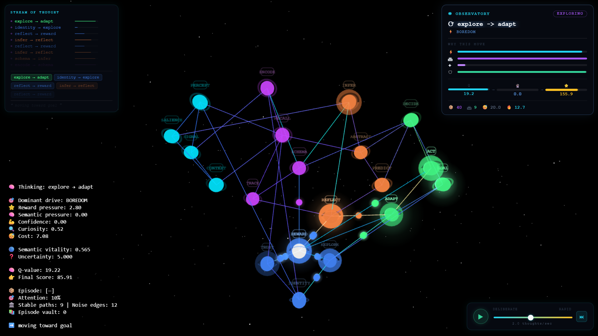

# MiniFlyWire

> A real-time 3D agent that moves through a 20-node concept graph — and an audit-driven
> research programme that measures which of its mechanisms actually change what it does.

<p align="center">
  
</p>

[▶️ 20-second demo](Portfolio_Assets/MiniFlyWire/assets/videos/demo.mp4) ·
**Portfolio:** https://manish-portfolio-one-gamma.vercel.app

---

## In 30 seconds

- **What it is.** A browser app (Three.js) where an agent chooses its next node by combining a
  learned score (Q-learning, reward and habit memory, trust) with a competitive arbitration step,
  and shows its internal state live in a HUD.
- **What makes it different.** I audited my own system, found that several of its "cognitive"
  modules did not affect behaviour, and then repaired and measured it under frozen,
  preregistered protocols with executable verification gates.
- **What is verified.** Six defects are repaired and gated:
  - the Q-value namespace;
  - scoring sign inversions;
  - goal-aware Q lookup;
  - seeded randomness;
  - the exploration branch;
  - the look-ahead id defect D2, repaired 2026-09-19.

  At the last full re-run of the 13 Phase 1.0 gate scripts (2026-09-15), 11 were fully green and 2 kept one historical
  failure each, superseded by corrected gates. Since FutureScore V2.3 (2026-09-20), one of those corrected gates fails its
  aggregate check S3.2′(b). That failure is recorded with a disposition, not repaired.
- **What is open.**
  - The executive controller has **no effect** on the main (60%) scoring path. It is not presented as solved.
  - The look-ahead built on the repaired D2 path (FutureScore V2.3) has **no demonstrated behavioural benefit**: its
    preregistered study ended UNRESOLVED.
- **What it is not.** It is not a demonstrated cognitive architecture. The audit's verdict — a
  heuristic scoring function over a fully observable graph — has not been overturned.
- **About the name.** The project is inspired by the FlyWire fruit-fly connectome project and is
  not affiliated with it. It uses no connectome data: the graph is 20 hand-authored concept nodes.

**Full evidence:** [`docs/VERIFICATION_STATUS.md`](docs/VERIFICATION_STATUS.md)

---

## Status at a glance

| Area | Status | Evidence |
|---|---|---|
| Q-learning value namespace (D1) | ✅ Repaired · verified | [`verify_S2.js`](experiments/phase1_0/verify_S2.js) |
| Scoring sign inversions (D3) | ✅ Repaired · verified | [`verify_S1.js`](experiments/phase1_0/verify_S1.js) |
| Goal-aware Q lookup (Q4) | ✅ Repaired · verified | [`verify_S2_Q4.js`](experiments/phase1_0/verify_S2_Q4.js) |
| Seeded, reproducible randomness (Q3) | ✅ Repaired · verified | [`verify_S4.js`](experiments/phase1_0/verify_S4.js) |
| Exploration branch (F2) | ✅ Repaired · invariant S3.2′(a) holds · ⚠️ aggregate check S3.2′(b) fails since FutureScore V2.3 (disposition recorded) | [`verify_S3prime.js`](experiments/phase1_0/verify_S3prime.js) · [FS-BD-01](research/preregistrations/FUTURESCORE_V2_3_BEHAVIORAL_DISPOSITION_01.md) |
| Executive controller → main scoring path | ❌ **Open** — inert (influence 0, capability 8.06) | [`exec_influence/report.json`](experiments/exec_influence/report.json) |
| Look-ahead id defect (D2) | ✅ Repaired 2026-09-19 · verified | [`experiments/d2/verify.js`](experiments/d2/verify.js) |
| Look-ahead planning (FutureScore V2.3) | ⚠️ Implemented · behavioural benefit UNRESOLVED (study closed) | [Study 2 disposition](research/preregistrations/FUTURESCORE_V2_3_STUDY2_DISPOSITION.md) |
| Prediction error in the browser app | ⚠️ Zero by construction — environment is fully observable | [Status §6](docs/VERIFICATION_STATUS.md) |
| Hidden-structure environment | 🧪 Harness only — not in the browser app | [`experiments/m7/env.js`](experiments/m7/env.js) |

---

## The cognitive testbed (`cognitive/`, added 2026-11-07)

The audit found that the browser agent reads the true map directly. `cognitive/` is a separate
Node.js testbed that fixes this: the environment owns reward and hidden state, agents see only
observations, and standard baselines (random, Q-learning, Dyna-Q, a learned-model planner) run on
the same task battery. It does not import the browser app, and the browser agent has not yet been
run on it.

| Gate | Result | Record |
|---|---|---|
| CF-01 — does the battery separate model-based from model-free agents? | ✅ PASS · E1 +149.2 [104.9, 203.1] and E3 +269.2 [113.3, 424.3] admitted · E2 not admitted | [results](experiments/cf01/results/RESULTS.md) |
| CF-01b — redesigned detour task E2′ | ✅ PASS · +318.3 [236.4, 398.8] | [results](experiments/cf01b/results/RESULTS.md) |
| CF-03 — learned-model planner (MBVI) against Dyna-Q | ❌ **FAIL on A4 calibration** (dev ECE 0.101, limit 0.05) · A1 E3 +220.4 [86.6, 372.8] held | [results](experiments/cf03/results/RESULTS.md) |

Roadmap and decisions: [`docs/COGNITIVE_MILESTONE_ROADMAP.md`](docs/COGNITIVE_MILESTONE_ROADMAP.md).
Module guide: [`cognitive/README.md`](cognitive/README.md).

---

## How a decision is made

```text
candidate neighbours
   ├─ learned score (60%)   Q-value, rewards, habits, trust, look-ahead, penalties, attention
   └─ arbitration   (40%)   competitive weighting of reward, semantic, confidence, curiosity, cost, schema
            ▼
   softmax → epsilon-greedy → move → Q-learning, reward and memory updates → HUD
```

The executive controller's weights are computed but read under field names that do not exist on
the 60% path — see [Status §5](docs/VERIFICATION_STATUS.md).

---

## Research method

- **Audit first.** A read-only audit with falsification probes:
  [`research/cognitive-audit/`](research/cognitive-audit/).
- **Preregistration.** Each study is written and frozen (SHA-256) before data collection:
  [`research/preregistrations/`](research/preregistrations/).
- **Executable gates.** Later verifiers include mutation tests that confirm a gate can fail.
- **Errata, never edits.** Failed or superseded gates stay in the repository and still run.
- **Null and inconclusive results are reported as such** (e.g. Q1: *inconclusive — insufficient
  material*).

---

## Run it

**Browser app.** The page loads `neurons.json` and `connections.json` with `fetch`, so serve the
repository root over HTTP (any static server), then open `index.html`. Three.js loads from a CDN.

```bash
python -m http.server 8000
```

Press **Space** to start or stop the agent. Click nodes to interact. **Shift+R** resets learned
state.

**Tests.** Node.js 24 or later, no install step and no dependencies. This runs the 93 unit,
isolation and mutant tests of the cognitive testbed, and is what CI runs on every push.

```bash
npm test
```

**Verification gates.** Node.js only, no install step. Gates in `experiments/phase1_0/` must be
run from that directory.

```bash
cd experiments/phase1_0
```

```bash
node verify_S2.js
```

---

## Repository layout

| Path | Contents |
|---|---|
| `index.html`, `main.js` | Browser entry point and agent loop |
| `render/` | Scoring, Q-learning, memory, motivational state, visualisation modules |
| `instrumentation/` | Seeded RNG, telemetry bus, trace schema, session recorder |
| `benchmarks/harness/` | Headless shim that runs the real `main.js` under Node |
| `experiments/` | Gates (`phase1_0/`, `d2/`), controller measurement (`exec_influence/`), studies (`m7/` onward, `c1/`, `q1/`, `uqa/`, `uqb/`, `study2/`, `h1r/`, `mcf1/`, `xfer1/`, `xfer2/`, `gate-floor*/`, `learn0/`) |
| `cognitive/` | Separate testbed with an environment–agent boundary, baseline agents and tests ([guide](cognitive/README.md)) |
| `research/` | Audit, preregistrations, errata, interpretations, decision log (`09_decisions.md`) |
| `docs/` | [`VERIFICATION_STATUS.md`](docs/VERIFICATION_STATUS.md) and the `COGNITIVE_*` handbook, audit and roadmap |
| `scripts/` | `test.mjs`, the runner behind `npm test` |
| `Portfolio_Assets/MiniFlyWire/` | Design documents and media. They describe design intent and predate the audit; where they differ, `docs/VERIFICATION_STATUS.md` is current. |

---

## License

MIT — see [`LICENSE`](LICENSE). To cite the project, see [`CITATION.cff`](CITATION.cff).
