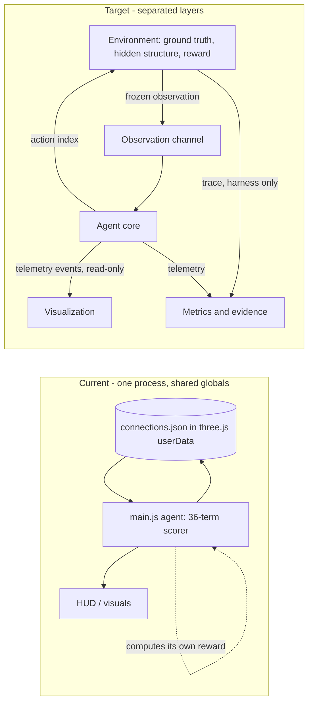
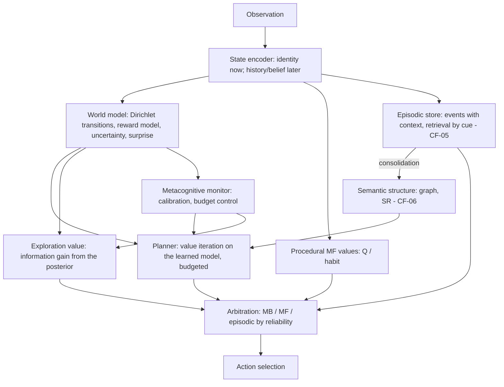

# MiniFlyWire Cognitive Architecture Handbook

**Status 2026-11-07:**
- Audit complete.
- Target architecture specified.
- CF-01 (testbed) is the first implementation milestone. It passed its development gate on 2026-11-07, with E1 and E3 admitted and E2 not admitted; see [`experiments/cf01/results/RESULTS.md`](../experiments/cf01/results/RESULTS.md).
- Nothing in this package claims that MiniFlyWire is cognitive today.

| Document | Holds |
|---|---|
| [`COGNITIVE_AUDIT.md`](COGNITIVE_AUDIT.md) | Repository truth, runtime map, module status, signal paths, oracle leaks: the evidence for §2–§5 |
| [`COGNITIVE_RESEARCH_REVIEW.md`](COGNITIVE_RESEARCH_REVIEW.md) | Literature by mechanism, with fit and simpler alternatives |
| [`COGNITIVE_EXPERIMENT_PROTOCOL.md`](COGNITIVE_EXPERIMENT_PROTOCOL.md) | Benchmark battery, baselines, statistics, the CF-01 development gate |
| [`COGNITIVE_METRICS.md`](COGNITIVE_METRICS.md) | Metric definitions and acceptance criteria |
| [`COGNITIVE_MILESTONE_ROADMAP.md`](COGNITIVE_MILESTONE_ROADMAP.md) | CF-01 … CF-08 |
| [`COGNITIVE_DECISIONS.md`](COGNITIVE_DECISIONS.md) | Engineering decision records CD-001 … |
| [`COGNITIVE_RISKS_AND_LIMITATIONS.md`](COGNITIVE_RISKS_AND_LIMITATIONS.md) | Risks, limits, non-goals |
| [`MINIFLYWIRE_COGNITIVE_DESIGN_REPORT.md`](MINIFLYWIRE_COGNITIVE_DESIGN_REPORT.md) | Paper-style design report |

Governance is unchanged:
- Director rulings live in `research/09_decisions.md` (D-0xx). This package does not edit that file.
- The records `CD-xxx` in `COGNITIVE_DECISIONS.md` are engineering decisions, not rulings.
- AC38 and TC-2 records, gates and trees are outside this work.

---

## 1. Research objective and operational definition of cognition

**Objective.** To find out whether an artificial agent can acquire, organise, construct, transfer and apply knowledge through continuous interaction with an environment. The evidence must be reproducible.

This is not a claim of AGI, consciousness, human-level intelligence or brain equivalence.

**Operational definition.** MiniFlyWire counts as doing *more than reactive graph navigation or hand-written scoring* only when it passes **controlled behavioural tests** in which the needed knowledge is **hidden from the agent** and must be learned. The difference must hold against matched baselines that lack the mechanism under test.

| # | Capability | Behavioural test (`COGNITIVE_EXPERIMENT_PROTOCOL.md`) | Counts as evidence only if |
|---|---|---|---|
| C1 | Acquire latent structure through interaction | Latent learning (E1) | Unrewarded exposure improves later goal-directed performance relative to no exposure, beyond the same contrast in model-free Q |
| C2 | Learn transition dynamics, not receive the map | Held-out transition prediction; all tasks are map-off | Predictive log-likelihood exceeds a uniform-over-exits model; no privileged channel is used (leak tests pass) |
| C3 | Use learned knowledge to plan | Revaluation with a cue (E3), detour (E2) | The first post-change episode is better than a model-free baseline with the same experience |
| C4 | Adapt to structural change | Hidden reliability change (E4) | Recovery or switch rate exceeds a fast-forgetting model-free control |
| C5 | Revalue known states | Reward relocation (E3) | Perseveration at the old goal falls faster than in Q |
| C6 | Construct a detour | Detour (E2) | Detour success in the first post-block episode exceeds Q |
| C7 | Retrieve relevant past experiences | One-shot contextual recall (E7, needs partial observability) | Context-matched recall changes choice; context-mismatch control does not |
| C8 | Transfer structure | Related-world transfer (E5) | Better than fresh, and better than a mismatched-family control |
| C9 | Calibrated uncertainty | Calibration (metrics §4) | Expected calibration error ≤ a pre-set bound, and uncertainty rises after hidden change |
| C10 | Behaviour changes because of memory, motivation, prediction and executive control | Ablations (E7–E9) | Removing the named mechanism degrades the matching test, while the other tests stay put |

**What never counts:**
- A module existing, being imported or being displayed.
- A score term carrying a cognitive name.
- Behaviour that a privileged channel explains, such as the true map, true distances or agent-computed reward from goal identity.
- Performance on one fixed goal on a fully known graph.

---

## 2. Current architecture: audit findings

The evidence is in [`COGNITIVE_AUDIT.md`](COGNITIVE_AUDIT.md).

- **What it genuinely does.**
  - It navigates a fixed 20-node graph to a fixed goal at 8.8× a random walk.
  - It does so with model-free, success-reinforced familiarity: Q, trust, visit and transition counts, local emotion and episode adjacency.
  - It has privileged access to the true map: BFS goal distance, DFS reachability and FutureScore look-ahead.
  - It is seeded and deterministic, with extensive instrumentation.
- **What does not change decisions:**
  - The executive controller: 0 of 6,908 argmax changes.
  - Motivational drives: all drive terms are 0.
  - The global curiosity, confidence, stress and fatigue states: identical across candidates. Fatigue acts only through the exploration rate.
  - Working memory: never written.
  - Imagined steps beyond the first: 24,912 per session, never executed.
  - Uncertainty and the ledger: unused by the scorer.
  - Momentum and activation competition: write-only.
- **What is missing:**
  - An environment object, an observation boundary and environment-emitted reward.
  - A learned transition model and planning on learned knowledge.
  - Recall by cue.
  - Adaptive computation.
  - Any discriminating benchmark.
- **Classification:** a graph-navigation RL agent that is cognitive-inspired in naming only (audit §9).
- **Most fundamental blocker.** There is no separation between environment and agent, so no task hides knowledge the agent must learn. Every capability test is impossible until that exists (audit §6–§7; Phase 0 §2).

---

## 3. Current versus target architecture





---

## 4. Module inventory and data-flow maps

The complete module table, call counts and signal paths are in the audit (§3–§5).

The table below maps each existing module to its target role. **No module is deleted.** Existing modules keep running in the legacy agent, and a module is reused in the target core only after it passes the component tests of §9.

| Target subsystem | Legacy candidate | Reuse decision |
|---|---|---|
| Environment | `experiments/coga/envsim.mjs`, `experiments/m7/env.js` (reliability generator) | Ideas reused (CRN per-edge streams, hidden reliability); new testbed in `cognitive/testbed/` (CD-002) |
| World model | `trustMemory.js` (success counts), `predictionError.js` (transition uncertainty) | Neither is a transition model. Trust counts goal-path success. Rebuild as a Dirichlet model (CF-03) |
| Procedural MF | `qlearning.js` | Concept reused; the testbed baseline `QL` is a clean implementation |
| Episodic | `episodeManager.js` | Store schema and provenance reusable; retrieval does not exist (CF-05) |
| Semantic | `semanticMemoryLayer.js`, `schemaMemory.js`, `semanticVitality.js` | Marginal effect today; rebuilt from the world model (CF-06) |
| Arbitration | `executiveController.js` | Inert today; redesigned on reliability signals (CF-04) |
| Exploration | `behavior.js` curiosity, `motivationalState.js` | No decision effect; replaced by posterior information gain (CF-03/04) |
| Provenance | `semanticProvenance.js` | Adopt as the write-authority rule for every store |
| Visualization | `hud.js`, `neuronVisuals.js`, scene | Kept; turned into a read-only telemetry subscriber (CF-07) |

---

## 5. Capability maturity matrix

**Ratings:**
- **DEMO:** implemented and demonstrated.
- **IMPL:** implemented but not validated.
- **PART:** partially implemented.
- **NAMED:** only visualized or named.
- **MISSING.**

| | Capability | Rating | Evidence |
|---|---|---|---|
| A | Perception and state representation | PART | State = node id. Embeddings are random vectors trained by co-occurrence. Full observability, no observation model (audit §2.2) |
| B | Attention and selective processing | PART | Amplification term, 1.1–2.6% argmax changes; it selects nothing and re-weights Q/reward (audit §3.2) |
| C | Goal representation and motivation | PART | Goal = an externally set node id, used through the oracle (L1–L3). Drives: NAMED (0 effect) |
| D | Working memory | NAMED | `episodeRecordNode` never called; only a recent-node list is used, by repetition and integrity terms |
| E | Episodic memory | PART | Store used as goal-agnostic edge familiarity; no cue-based recall [MCF-0; XFER-2] |
| F | Semantic memory | PART | Four modules ≤0.06% each; hand-written `conceptRelations` filter |
| G | Procedural learning | **DEMO** (narrow) | Success-reinforced familiarity carries goal direction with all oracles removed (57.3% vs 23.4% uniform); restoring episodes raises reaches [XFER-1]. Fixed graph and goal only |
| H | Consolidation and retrieval | IMPL | Consolidation term 0.07%; replay +0.1 [−8.1, 7.9] [XFER-2] |
| I | Prediction and prediction error | IMPL | Computed; acts through ε and learning gating; scorer inputs unused |
| J | World-model learning | MISSING | No learned transition model is used for prediction or planning |
| K | Model-based planning | MISSING (learned) | Planning exists only over ground truth (FutureScore, goalDistance) |
| L | Counterfactual reasoning | NAMED | The imagination chain feeds a display only |
| M | Uncertainty and calibration | IMPL | Beta ledgers computed, unused in choice; no calibration test |
| N | Cognitive flexibility and revaluation | MISSING | No test; goal-agnostic familiarity misleads after a goal change [MCF-0 wrong-goal check] |
| O | Transfer and generalisation | PART | Same-graph cross-session transfer of familiarity [XFER-1]; no related-world test |
| P | Executive control and arbitration | NAMED | 0 of 6,908 argmax changes; weight keys mismatch |
| Q | Metacognition and adaptive computation | MISSING | Fixed computation |
| R | Long-horizon behaviour | MISSING (untested) | Graph diameter 4; no long-horizon task |

---

## 6. Literature

See [`COGNITIVE_RESEARCH_REVIEW.md`](COGNITIVE_RESEARCH_REVIEW.md). Its §15 orders the mechanisms. The essential points:
- The cognitive-map signatures (latent learning, detour, revaluation) define the benchmark.
- The MB/MF distinction defines the first missing mechanism.
- Tabular Bayesian world models with count-based exploration are the simplest defensible implementation.
- Episodic memory is justified only once partial observability makes it necessary.

---

## 7. Proposed mechanisms and alternatives

| Mechanism | Problem solved | Chosen implementation | Alternatives considered | Why this one |
|---|---|---|---|---|
| Environment–agent separation | Unmeasurable cognition | `GraphEnv` with private state, frozen observations, permuted action labels, environment-emitted reward | Extend COG-A `CogaEnv`; patch `main.js` | COG-A is study-locked and gives agents the topology; patching production first gives no test bed (CD-001, CD-002) |
| World model | No learned dynamics | Dirichlet transition counts + reward model + posterior uncertainty | Deterministic last-outcome model (Dyna); neural model | Exact, calibrated in stationary worlds, inspectable; Dyna kept as baseline |
| Planner | No planning on knowledge | Value iteration on the posterior-mean model with a step budget | MCTS; prioritised sweeping | Exact at this scale; prioritised sweeping later as an efficiency ablation |
| Exploration | Undirected ε | Information-gain / optimism bonus from posterior counts | Curiosity from prediction error; EFE | Guarantees in tabular MDPs; robust to noisy edges with a learnability term |
| Arbitration | Inert executive | Choose MB vs MF by recent prediction reliability and planning cost | Fixed MB; learned gate | Testable signature (Daw 2005); fixed MB is its baseline |
| Episodic memory | Non-Markov contingencies | Event store keyed by context; k-NN retrieval; provenance | Bigger state (history window) | Kept as baseline; episodic only after the history baseline fails a task |
| Semantic consolidation | Transfer | Structure prior (transition-count hyper-parameters) + SR | TEM/CSCG latent models | Minimal structural transfer first |

---

## 8. Environment and agent interface contracts

These contracts are implemented by CF-01 in `cognitive/testbed/` (see `cognitive/README.md`).

### 8.1 Environment (authoritative; the only source of ground truth)

```
const env = new GraphEnv(world, { seedLabel, maxSteps })
env.reset({ start?, goal?, cue? })    → Observation
env.step(actionIndex)                 → { obs: Observation, reward: number, done: boolean, truncated: boolean }
```

Runner-only controls exist for task phases: `setGoal`, `setCue`, `block`, `unblock`, `setReliability`. They are not passed to agents. `trace()` returns a copy of the trajectory log for metrics.

**Determinism.** Every random draw comes from named seeded streams derived from `seedLabel`:
- per-edge transition streams, which give common random numbers across agents;
- a start stream;
- a world-generation stream.

The wall clock is never read.

### 8.2 Observation (frozen; the only thing an agent sees)

| Field | Type | Meaning |
|---|---|---|
| `node` | integer | Opaque label of the current node (a per-world random relabelling of internal ids) |
| `nActions` | integer | Number of exits at this node |
| `goal` | integer or null | Goal cue (a node label) when the task cues it; `null` otherwise |

The observation carries nothing else: no edges, distances, reliabilities or labels of other nodes. **Action `i`** traverses the i-th exit under a hidden per-node permutation. The label order carries no topology.

### 8.3 Dynamics and reward (environment-owned)

- **Traversal.** Exit `i` from node `s` leads to `v`. It succeeds with hidden probability `p(s,v)`, otherwise the agent stays at `s`. A blocked edge always fails.
- **Reward.** 1 on arrival at the rewarded node, which ends the episode. 0 otherwise.
- **Truncation.** At `maxSteps` the episode is truncated, which is distinct from done.
- **Goal entry obeys the same dynamics as every other move.** This removes audit leak L7.

### 8.4 Agent

```
const agent = makeAgent(kind, { rng, params })
agent.act(obs)                        → actionIndex
agent.observe({ obs, action, reward, next, done, truncated })
agent.onPhase?(info)                  // task boundary notice: { phase }; no environment data
```

- Agents receive randomness only through `rng`.
- Agents import nothing from `cognitive/testbed/` except `agent_util.mjs`. `Math.random` and `Date.now` are forbidden. Both rules are checked statically.
- **Privileged channel.** Only an agent that declares `privileged: true` (the ORACLE reference) receives `oracle.bestAction(nodeLabel)`. Its results are labelled ORACLE and never compared as a learner.

### 8.5 Visualization rule

Visualization subscribes to telemetry and never feeds anything back. **No agent may read from a visualization object.** For the legacy app this is a CF-07 requirement; the testbed has no visualization.

---

## 9. Learning, memory and planning architecture: subsystem specifications

Subsystems are built in roadmap order. Each one has a single owner of its state, an API-only write path and a provenance tag on every write: `experience`, `replay`, `planning` or `manual`. Manual writes are forbidden in experiments.

| Subsystem | Responsibility | Inputs → outputs | State and owner | Update timing | Learning rule | Read/write permissions | Failure modes | Metrics | Tests |
|---|---|---|---|---|---|---|---|---|---|
| **Environment** (CF-01) | Ground truth, dynamics, reward | action → obs, reward, done | topology, reliability, goal, streams; `GraphEnv` private fields | per step | — | Only the runner may configure; agents act only | Leak through obs or globals; non-determinism; CRN broken | — | schema, freeze, import isolation, CRN, statistics, blocked edges, mutants |
| **State encoder** (CF-01 identity; CF-05 history) | Observation → state key | obs (+history) → key | none / bounded history buffer | per step | — | agent-internal | Aliasing unhandled | state-aliasing error rate (CF-05) | identity and history unit tests |
| **World model** (CF-03) | Predict transitions and rewards, with uncertainty | (s,a,s′,r) → p̂(s′\|s,a), p̂success, uncertainty, surprise | Dirichlet counts per (s,a), reward stats; owner WM | per step | count += 1; posterior mean (n+α)/(N+Kα) | write: experience only; read: planner, exploration, monitor | Overconfidence after change; prior dominance | held-out log-likelihood, ECE, change-detection latency | exact posterior unit tests; calibration on synthetic worlds |
| **Planner** (CF-03) | Values for the current goal from the model | WM, goal cue, budget → Q_MB(s,·) | value table (cache invalidated on model change) | per decision, budgeted | value iteration, γ fixed a priori | read WM; write own cache | Stale cache; budget too small | planning steps, regret vs oracle | VI against a closed-form solution on small graphs |
| **Procedural MF** (CF-01 baseline; CF-04 component) | Fast cached values | (s,a,r,s′) → Q_MF | Q-table | per step | one-step Q-learning (α, γ) | experience and replay | Perseveration after change | perseveration index | TD update unit tests |
| **Exploration value** (CF-03/04) | Directed exploration | WM counts → bonus(s,a) | none (derived) | per decision | bonus = β/√(n+1) or information gain | read WM | Noise capture | coverage speed; noisy-edge share | noisy-edge control |
| **Arbitration** (CF-04) | Choose a controller | Q_MB, Q_MF, reliabilities, cost → action and controller id | reliability trackers | per decision | reliability = running prediction accuracy | read controllers | Never switching; flapping | controller share; switch latency after change | forced-reliability unit tests; ablation |
| **Metacognitive monitor** (CF-04) | Calibration and budget control | predicted vs realised success → budget, bonus scale | calibration bins | per step | running ECE | read WM, write planner and exploration settings | Feedback oscillation | ECE; budget trace | synthetic miscalibration test |
| **Episodic store** (CF-05) | One-shot events with context | event → store; cue → top-k events | ring store with provenance | write per step; retrieve per decision | none (storage); eviction by priority | write experience; read arbitration and consolidation | Retrieving irrelevant events | recall precision; context-mismatch effect | retrieval unit tests; mismatch control |
| **Semantic structure** (CF-06) | Reusable structure; transfer | WM + episodes → graph prior, SR | consolidated tables | per episode end | SR TD; prior estimation | write consolidation only | Over-generalisation | transfer gain vs mismatched control | prior-transfer unit tests |
| **Action selection** | Final choice | arbitrated values → action | none | per decision | ε-greedy or softmax with a seeded stream | — | — | exploration share | determinism |

**Single sources of truth.**
- Transitions live only in the world model.
- Values live in the planner cache (MB) and the Q-table (MF), each tagged by controller.
- Episodes live only in the episodic store.
- No other module keeps a parallel copy. This is the main fix for audit §8 (duplicated familiarity).

---

## 10. Benchmarks and baselines

The battery is defined in [`COGNITIVE_EXPERIMENT_PROTOCOL.md`](COGNITIVE_EXPERIMENT_PROTOCOL.md):

| Code | Task |
|---|---|
| E1 | Latent learning |
| E2 | Detour |
| E3 | Revaluation (cued goal switch; reward relocation) |
| E4 | Hidden structural change |
| E5 | Transfer |
| E6 | Partial observability |
| E7–E9 | Memory, motivation and planning ablations |
| E10 | Long horizon |

**Baselines:**
- `RANDOM` (uniform);
- `QL` (tabular Q);
- `DYNAQ` (Dyna-Q);
- `ORACLE` (privileged shortest path, the upper bound);
- later `MBVI` (learned-model planner), `SR`, a belief or active-inference agent, and MFW-legacy in declared ORACLE-MAP and MAP-OFF modes (CF-02).

CF-01 admits E1–E3 to the battery only if they discriminate MB from MF on the pre-declared gate.

## 11. Metrics and acceptance criteria

See [`COGNITIVE_METRICS.md`](COGNITIVE_METRICS.md):
- per-task primary metrics;
- paired, world-level contrasts with percentile-bootstrap 95% intervals;
- calibration (ECE, Brier);
- leak tests as hard gates;
- determinism as a hard gate.

## 12. Reproducibility and experiment governance

- **Seeds.** Seeds are derived from string labels with SHA-256. Domains are disjoint (`dev`, `gate`, later `confirm`). The repository's registered M7 seed blocks and held-out ranges are never used.
- **Development versus confirmatory.** Development runs never use confirmatory domains. Every confirmatory protocol is committed before its run. A development gate (CF-01) is likewise frozen in a commit before its gate-domain run.
- **No tuning after outcomes.** Hyper-parameters are fixed in the frozen spec. A failed gate is reported and becomes a new milestone, never a silent re-run.
- **Records.** Every run records commands, exit codes, Node version, platform, HEAD, result hashes and the spec hash.
- **Evidence classes.** Every report labels its evidence as static inspection, synthetic or unit test, development run, or confirmatory run.
- **Independent validation.** Major scientific claims, meaning any claim of C1–C10 at the confirmatory level, need selective independent reproduction. Ordinary development does not need human approval at each step. Push and publication need separate authorisation.
- **Clean separation from the governed studies.** No AC38, TC-2 or pinned-tree file is touched. No registered seed is consumed.

## 13. Security and oracle-leakage controls

| Control | Mechanism | Where enforced |
|---|---|---|
| Observation schema | Exactly three keys, primitive values, frozen | `cognitive/tests/test_env.mjs` |
| No hidden channel through globals | No new `globalThis` keys after env construction and use | `cognitive/tests/test_isolation.mjs` |
| Import isolation | Agent files may import only `agent_util.mjs` | static scan in tests |
| Forbidden APIs in agents | `Math.random`, `Date.now`, `performance`, `process`, `require`, dynamic `import()` | static scan |
| Action-label permutation | Labels are not sorted-neighbour order on a majority of nodes | env test |
| Privileged channel | Given only to `privileged: true` agents; results labelled | runner test |
| Mutation tests | Each control has a mutant that the matching named check must catch | `cognitive/tests/test_mutants.mjs` |
| Legacy app | Oracle inventory L1–L13 (audit §6); MAP-OFF mode only with an authorised production hook (CF-02) | — |

## 14. Engineering roadmap and dependencies

Summary. The full milestones are in [`COGNITIVE_MILESTONE_ROADMAP.md`](COGNITIVE_MILESTONE_ROADMAP.md).

| Milestone | Delivers |
|---|---|
| **CF-01** | Testbed and discriminating battery |
| CF-02 | MFW-legacy adapter: ORACLE-MAP now; MAP-OFF if a production hook is authorised |
| CF-03 | World model, planner and directed exploration (the first new cognitive mechanism) |
| CF-04 | Arbitration and metacognitive calibration |
| CF-05 | Partial observability, history/belief and episodic retrieval |
| CF-06 | Structural transfer and consolidation |
| CF-07 | Integration of the validated core into the MiniFlyWire app behind a flag, with visualization as a subscriber |
| CF-08 | Confirmatory study with independent reproduction |

## 15. Risks, limitations and non-goals

See [`COGNITIVE_RISKS_AND_LIMITATIONS.md`](COGNITIVE_RISKS_AND_LIMITATIONS.md). The chief risks:
- Tasks too easy to discriminate.
- Benchmark overfitting.
- A small graph inflating effects.
- The legacy integration reintroducing oracles.

The chief non-goal is any claim of general intelligence.

## 16. Relationship to Noetica, Velith and Mini Prometheus

The canonical architecture is unchanged: **MiniFlyWire → Noetica → Velith → Mini Prometheus.**

| Layer | Role | What it receives from this work |
|---|---|---|
| MiniFlyWire | Controlled lab: mechanisms are proposed and falsified here | Everything in this package |
| Noetica | Reusable cognition and memory layer | Only mechanisms that passed a confirmatory test, exported with their contracts. Candidates: the world model with uncertainty, the episodic store with provenance and a cue API, the budgeted planner. No dependency on MiniFlyWire's visualization or globals |
| Velith | Design and geometry intelligence | The environment-interface discipline (reset/step, seeded, privileged-channel separation) for its simulators; no cognitive component until validated |
| Mini Prometheus | Manufacturing execution | Uncertainty-aware planning and calibration are the long-term targets (for example, plans that know when a step is unreliable). No direct coupling to MiniFlyWire |

**Mechanism transfer rule.** A mechanism moves up a layer only with three things:
1. its confirmatory evidence;
2. its contract tests;
3. a statement of the conditions under which it was validated.

Nothing moves on the strength of a name.
