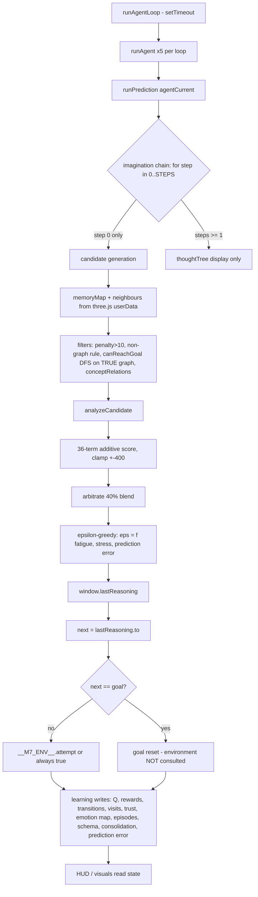

# MiniFlyWire Cognitive Audit (current state, 2026-11-07)

Part of the cognitive research package; the entry point is [`COGNITIVE_ARCHITECTURE_HANDBOOK.md`](COGNITIVE_ARCHITECTURE_HANDBOOK.md).

**Question.** Which cognitive capabilities exist in the running agent, judged by whether they change what it does?

**Evidence labels used throughout:**
- **[S]** static reading of the code at the stated HEAD.
- **[R]** runtime observation from the CF-00 probe (`experiments/cf00_audit/`, results in `results/audit_summary.json`).
- **[P]** a prior committed study, cited by path.

ACQ-1 is void under D-035, and no ACQ-1 number is used here.

This audit replaces nothing. The Phase 0 audit (`research/cognitive-audit/05_VERDICT.md`, 2026-08-17) and its later engineering record (`docs/VERIFICATION_STATUS.md`) stay as written. This document re-audits the runtime after the last production change (`952c9fc`, 2026-09-20) with new runtime evidence.

---

## 1. Repository truth

| Item | Value |
|---|---|
| Root / remote | Repository root of a local checkout · `origin` = the project's public GitHub repository |
| Branch / HEAD | `main` at `6b7bac0` (AC38 preservation commit). Local `main` is 2 ahead of `origin/main` (`3dc0082`); `c665fc3` and `6b7bac0` are unpushed |
| Working tree at audit start | 0 tracked changes, 0 staged; 43 untracked files (protected, untouched); 1 stash entry (untouched) |
| Last runtime-changing commit | `952c9fc` 2026-09-20 "FutureScore V2.3: implement the consumer…". Every later commit is experiments, research records or TC-2/AC38 documentation |
| Production surface | `main.js` (5,699 lines) + 38 `render/*.js` (11,411 lines); SHA-256 digest of the 39 files `9b8407c3…` [R] |
| Graph data | `neurons.json` 20 nodes in 5 labelled clusters; `connections.json` 39 undirected edges |
| Runtime entry points | Browser: `index.html` → `main.js` (ES modules, three.js 0.158 from CDN). Headless: `experiments/phase1_0/_driver.js` + `benchmarks/harness/headlessShim.js`. M7 runs: `experiments/m7/run.js`. COG-A: `experiments/coga/` |
| Tests | No unit-test suite for modules. 120 tracked `verify_*` / `test_*` files gate specific defects and studies. The production gates are listed in `docs/VERIFICATION_STATUS.md` §4 |
| Decision records | `research/09_decisions.md` (D-001…D-044; hash-pinned by `experiments/tc2/verify_contract.mjs`, so not edited here) |
| Prior cognitive audits | Phase 0 (`research/cognitive-audit/00–05`), MCF-0 (not committed), COG-A M1 (`experiments/coga/M1_AUDIT.md`) |

---

## 2. Runtime map

### 2.1 Control flow of one step [S]

### 2.2 The loop the mandate asks about, as built [S][R]

| Stage | Where | What actually happens |
|---|---|---|
| Environment | `connections.json` loaded into three.js meshes | There is no environment object. Topology lives in `userData.neighbors`, filled by the visual module `render/connections.js:120`. Transitions always succeed unless an experiment attaches `__M7_ENV__` |
| Observation | — | None. The agent reads the scene graph directly, and its "state" is the node id |
| State representation | `main.js` | Node id plus `recentMemory` (recent node list); random 32-d embeddings trained by co-occurrence (`embeddings.js`) |
| Perception / attention | `cognitiveAttention.js` | Re-weights `reward·3 + Q·2 + noise` by goal-embedding alignment |
| Candidate generation | `runPrediction` | Graph neighbours plus remembered nodes, filtered by an oracle reachability DFS (`canReachGoal`, depth 4, true graph) |
| Decision | `scoring.js` + `executiveController.js` | 36 additive terms; a 60/40 blend with `arbitrate`; ε-greedy |
| Action → transition | `runAgent` | `next = lastReasoning.to`. A goal-entering move skips the environment (`main.js:4992-5018`) |
| Outcome / reward | `runAgent` | **Reward is computed by the agent itself** (`rewardSignal`, `main.js:3982-4080`: 12 on reaching the goal, small similarity-based values otherwise). No environment emits reward |
| Prediction error | `predictionError.js` | Computed against an expectation; feeds epsilon and learning gating |
| Learning / memory | Q, maps, trust, emotion, episodes | Writes after the move; episodes are saved only when the goal is reached |
| Consolidation | `longTermConsolidation.js`, `episodeManager.replayOneEpisode`, `schemaMemory.rebuildSchemas` | Periodic passes; schema rebuild throttled by wall clock (`Date.now`) |
| Future decisions | the same 36 terms | — |

---

## 3. Decision-channel evidence (CF-00) [R]

**Setup.** 3,000 steps per session. Seeds 101, 202 and 303. Goal 16, or no goal. Cold store. One graph. The run on unmodified code was deterministic: the repeat of seed 101 was byte-identical.

### 3.1 What drives the executed move

| Measure | Goal 16 | No goal |
|---|---|---|
| Step-0 decisions / greedy decisions with ≥2 candidates | 8,304 / 6,908 | 8,263 / 7,198 |
| Mean candidates per decision | 4.68 | 4.21 |
| Imagined chain steps computed but never executed | 24,912 | 17,712 |
| Exploration draws (ε) | 1,287 (15.5%), ε 0.151–0.200 | 1,065 (12.9%), ε 0.088–0.200 |
| Arbitration blend active / argmax changed by it | 6,908 / **0** | 7,198 / **1** |
| Candidate scores at the ±400 clamp | 1,818 | 0 |
| Executed moves matching the step-0 choice | 6,132 / 6,668 (92.0%) | 8,079 / 9,015 (89.6%) |

### 3.2 Single-term knockouts (goal 16)

**Measure.** The share of greedy decisions whose argmax changes when the term is removed.

| Term (module) | Flip rate | Varies across candidates |
|---|---|---|
| goalGradientBoost (oracle `goalDistance` BFS) | 2.81% | 97.7% |
| qValue (`qlearning.js`) | 1.85% | 99.1% |
| attentionAmplifiedScore (`cognitiveAttention.js`) | 1.09% | 99.2% |
| trustBonus (`trustMemory.js`) | 1.00% | 99.2% |
| repetitionPenalty | 0.49% | 75.5% |
| trajectoryIntegrity (episode store) | 0.35% | 95.0% |
| transitionBoost | 0.30% | 99.1% |
| futureBonus (FutureScore, true-graph BFS) | 0.22% | 94.0% |
| schemaBonus | 0.16% | 88.8% |
| 13 further terms (local emotions, habit, consolidation, semantic vitality, noise suppression, dynamicFocus, drift, reward…) | 0.01–0.10% each | — |
| curiosityState, confidenceState, stressState, fatigueState, fatigueOverload | **0** | **0%**: identical for every candidate, so they cannot change an argmax |
| chainReward, driveGoalBoost, selfLoopPenalty | **0** | always 0 |
| driveRewardBoost, driveCuriosityBoost, curiosityBoost, localStress, localFear, dangerPenalty | 0 | — |

Single-term rates are low because the terms are strongly correlated. Group knockouts show the same ordering.

| Group | Goal 16 | No goal |
|---|---|---|
| Oracle goal gradient | 2.81% | 0 |
| Attention amplification | 1.09% | 2.63% |
| Q-learning | 1.01% | 1.22% |
| Bayesian trust | 1.00% | 0.39% |
| Visit/transition counts and recency | 0.59% | **11.73%** |
| Schema/semantic/consolidation (5 modules) | 0.59% | 0.60% |
| Episodic trajectory integrity | 0.35% | 0 |
| FutureScore look-ahead | 0.22% | 0 |
| Global behaviour states + drift | 0.13% | 2.65% (drift: a random tie-breaker) |
| Local emotion map | 0.12% | 0.28% |
| Motivational drives | 0 | 0.04% |

### 3.3 Closed-loop ablations (goal 16, 3 seeds each; descriptive, n = 3)

| Condition (channel removed at its source) | Goal arrivals, 3 × 3,000 steps | First arrival (env move, per seed) | Non-graph moves |
|---|---|---|---|
| BASE | **2,347** (848/761/738) | 2/3/6 | 2.7% |
| Uniform random walk on the true graph (reference) | 266 (88.6 per session) | — | — |
| NOGG (goal gradient) | 2,075 | 2/3/6 | 7.4% |
| NOFUT (FutureScore) | 2,243 | **151/62/29** | 5.0% |
| NOREACH (reachability filter) | 3,110 | 2/3/3 | 12.4% |
| NOORACLE (all three) | 2,097 | 5/8/7 | 10.8% |
| NOORACLE + no Q, reward, penalty | **1,877** | 5/8/7 | 7.1% |
| NOQ / NOEPI / NOSEM / NOATT / NOTRUST / NOAFFECT | 2,682 / 2,656 / 2,612 / 2,637 / 2,887 / 2,638 | ≈ BASE | 3–9% |

Restart positions after an arrival were spread over true distances 1–4 (mean 2.5–2.8). BASE needs 2.5–3.1 non-goal moves per arrival, against a mean true distance of 2.47.

**Reading.**
- Goal reaching is fast, 8.8× a random walk, and **over-determined**. No single named subsystem is necessary for it.
- Removing every oracle channel together with Q, reward and penalty still leaves 80% of BASE arrivals.
- In those oracle-free runs the goal direction is carried by `trustBonus` (+33 points on the distance-minimising candidate), `localConfidence` (+20), `trajectoryIntegrity` (+18), attention (+14) and `transitionBoost` (+12). The winner was the distance-minimising candidate in 57.3% of decisions, against 23.4% for uniform choice (BASE 61.5%).
- These stores are all reinforced by the agent's own goal-dependent reward and by success credit given to every edge of a goal-reaching path (`main.js:4675`). They are **goal-path familiarity learned for one fixed goal**: procedural, model-free learning.
- FutureScore, a look-ahead over the true graph, makes the first arrival immediate. Without it the first arrival took 29–151 moves in 2 of 3 seeds.
- The n = 3 differences between the other ablations are not interpreted.

### 3.4 Runtime call counts (one 3,000-step session, V8 precise coverage) [R]

| Module | Named functions run | Calls | Exported functions never called |
|---|---|---|---|
| `main.js` | 13/18 | 7,392,746 | — |
| `planning.js` | 5/6 | 5,611,697 | `lookAheadScore` |
| `search.js` | 2/2 | 5,784,261 | — |
| `traversalRecord.js` | 4/5 | 4,155,260 | `clear` |
| `executiveController.js` | 4/5 | 638,638 | `explainArbitration` |
| `qlearning.js` | 6/6 | 354,611 | — |
| `uncertaintyLedger.js` | 10/13 | 212,924 | `registerOllamaPair`, `getCombinedUncertainty`, `getLedgerSummary` |
| `motivationalState.js` | 7/7 | 200,053 | — |
| `semanticMemoryLayer.js` | 7/8 | 141,995 | `isNoiseEdge` |
| `cognitiveAttention.js` | 7/9 | 140,912 | `setGoalAttention`, `weakenAttention` |
| `predictionError.js` | 10/12 | 113,180 | `peekTransitionUncertainty`, `getSemanticExpectationConfidence` |
| `emotionMap.js` | 3/3 | 99,850 | — |
| `episodeManager.js` | 15/22 | 60,434 | `recordManualClick`, `loadEpisodes`, `exportEpisodes`, `getEpisodeStats`, … |
| `activationCompetition.js` | 3/12 | 3,223 | 8 of 11, including every read accessor |
| `momentumMemory.js` | 1/2 | 1,110 | `getMomentumBonus` (the only reader) |
| `episodicContextEngine.js` | 8/19 | 9,968 | `episodeRecordNode`, `wmAddNode`, `wmGetActivation`, … |
| `semantic.js` | 0/1 | 0 | `buildSemanticMap` |
| `episodic.js` | not loaded | — | not imported by any runtime module |

The full table, covering all 39 production files plus `instrumentation/rng.js`, is in `results/audit_summary.json` → `coverage`.

---

## 4. Module status

**Classes:**
- **ACTIVE:** changes the executed action at a measurable rate (≥0.5% of decisions open-loop), or gates the candidate set.
- **PARTIAL:** connected, but only some outputs reach decisions, or only through epsilon or learning.
- **INERT:** no measurable decision contribution.
- **DUP:** overlaps another subsystem.
- **UNVERIFIED:** the evidence is insufficient.
- **VIS:** visualization or UI only.

"Learns" means the module's state changes from the agent's own experience. "Tested" names a gate that asserts the module's behaviour, not just files that mention it.

| Module | Intended | Actual [S][R] | State it owns | Affects action? | Learns? | Tested | Issues | Class |
|---|---|---|---|---|---|---|---|---|
| `main.js` | app + agent | Bootstraps the scene; the agent loop; candidate generation; scoring; learning writes; brain save/load; oracle graph functions | 33 top-level stores | yes (it is the agent) | yes | S1–S4, S3′, G9 gates | 2,000-line `runAgent`; agent state on three.js objects; agent-computed reward; goal-entry bypass of the environment | ACTIVE |
| `scoring.js` | final decision score | 36 fixed-weight additive terms, clamp ±400 | `lastArbitrationBreakdown` | yes | no | `parity_termarray.js`, S1 | 5 candidate-constant terms; 3 always-zero terms; `...rest` swallows procedural uncertainty; `transitionUncertainty`, `sequenceError`, `uncertaintyState` accepted but unused | ACTIVE |
| `qlearning.js` | value learning | Goal-keyed tabular Q; TD updates from the agent's own reward | `Q` | 1.0–1.9% | yes | S2, S2_Q4 | Redundant with the familiarity stores; removal did not lower arrivals (n = 3) | ACTIVE, DUP |
| `trustMemory.js` | Bayesian reliability | (successes+1)/(attempts+2) per edge. A success is credited to every edge of a goal-reaching path, so it measures goal-path familiarity, not transition reliability (unless the M7 credit hook is on) | `pathSuccesses`, `pathAttempts` | 1.0%; main goal carrier without oracles | yes | G16 | The name overstates it | ACTIVE |
| `cognitiveAttention.js` | selective attention | Multiplies `reward·3+Q·2+noise` by goal-embedding alignment | focus vector | 1.1% (goal), 2.6% (no goal) | weakly | none | Re-weights terms already in the score; selects nothing | ACTIVE, DUP |
| `memory.js` | transition/reward memory | Shared Maps: transitions, rewards, penalties, visits, confidence, thought trail | 9 Maps/arrays | 0.6% (goal), 11.7% (no goal) | yes | via S-gates | Visit counts dominate goal-free behaviour | ACTIVE |
| `episodeManager.js` | episodic memory | Stores successful episodes; replay writes Q. Read only as edge counts (adjacency gate, trajectory integrity, schemas) | `episodicStore` | 0.35% direct; also via the adjacency gate | yes | many study harnesses | Goal-agnostic familiarity, not recall [P: MCF-0, `experiments/xfer2/results/RESULTS.md`]; replay contributes +0.1 [−8.1, 7.9] [P] | ACTIVE (as familiarity) |
| `planning.js` | future planning | FutureScore V2.3: BFS over the true graph with traversal evidence | `H` | 0.22%; removal delays the first arrival | no | 39 files incl. `futurescore/` | Look-ahead over ground truth (oracle); `lookAheadScore` never called | ACTIVE (oracle) |
| `traversalRecord.js` | evidence boundary for FutureScore | Records actual traversal outcomes | `record` | via FutureScore | yes | `futurescore/` gates | — | PARTIAL |
| `candidateAnalysis.js` | analyse one candidate | Computes `meaningBoost`; rejects candidates via `canReachGoal` (true graph) | none | filter + 0.01% | no | none | Oracle filter | PARTIAL |
| `knowledge.js` | knowledge | Hand-written `conceptRelations` (5 clusters × 4 labels) used as a candidate "logic filter" | `conceptRelations` | filter (not measured) | no | none | Designer-supplied structure (privileged prior) | PARTIAL |
| `embeddings.js` | semantic embedding | Random 32-d vectors nudged by co-occurrence; similarity feeds meaning, attention, reward | vectors on meshes | via other terms | yes | via S4 | Random geometry presented as "meaning" | PARTIAL |
| `emotionMap.js` | path emotions | Per-edge confidence/stress/fatigue/trust/fear from outcomes | `localEmotionMap` | 0.12%; +20 goal carrier without oracles | yes | none | Duplicates trust/familiarity | PARTIAL, DUP |
| `behavior.js` | internal brain states | Global curiosity/confidence/stress/fatigue/focus | 12 scalars | **not via score** (identical across candidates); via ε (fatigue lowers ε to 0.088) | yes | none | Displayed states with no argmax effect | PARTIAL (ε only) |
| `predictionError.js` | predictive processing | Expectation vs outcome; transition uncertainty; sequence error | 14 stores | via ε boost and learning gating (share not separated) | yes | S6 | Outputs passed to the scorer are unused; mostly updated on the fallback branch [P: MCF-0] | PARTIAL / UNVERIFIED |
| `schemaMemory.js` | hierarchical abstraction | Motif bonus from episodes; rebuild throttled by wall clock | `schemas`, cache | 0.16% | yes | none | `Date.now` dependence | PARTIAL |
| `longTermConsolidation.js` | consolidation | Path reinforcement registry → consolidation score | registry | 0.07% | yes | none | Marginal | PARTIAL |
| `semanticVitality.js` | semantic layer | Semantic signal from episode learning | 3 Maps | 0.06% | yes | none | Marginal | PARTIAL |
| `semanticMemoryLayer.js` | cortical generalisation | Semantic edges; noise-suppression score | 4 stores | 0.06% | yes | none | Marginal | PARTIAL |
| `semanticActivation.js` | anti-perseveration | Refractory factor | 5 stores | not separated | yes | none | — | UNVERIFIED |
| `semanticProvenance.js` | write authority | Separates manual / autonomous / replay writes | log | gates writes | — | via gates | Good design idea; `writeTransition` never called | PARTIAL |
| `executiveController.js` | executive arbitration | `arbitrate()` 40% blend | none | **0 / 6,908** argmax changes | no | `exec_influence` | Scorer reads `.exploit/.explore`; `computeExecutiveWeights` returns `wReward…wCost`, so `exploitW = exploreW = 1` always | INERT |
| `motivationalState.js` | drives → weights | Drives; dominant drive; executive weights | 8 drives | **0** (drive terms 0; weights feed the inert blend) | yes | none | `driveGoalBoost` never non-zero | INERT |
| `uncertaintyEngine.js` | uncertainty | Surprise/inconsistency/novelty score | 4 Maps | only via the inert blend and a semantic damp | yes | none | — | INERT |
| `uncertaintyLedger.js` | epistemic Beta ledger | Beta evidence mass per edge | 10 | none (spread into `...rest`) | yes | none | `registerOllamaPair` never called | INERT |
| `episodicContextEngine.js` | working memory, context | WM and episode vault; `episodeRecordNode` never called | 14 | none | no | gated by `verify_determinism.js` [P] | Working memory is dead code | INERT |
| `activationCompetition.js` | lateral inhibition | Writes activations; no reader | 5 | none | — | none | Write-only | INERT |
| `momentumMemory.js` | thought momentum | Learns momentum; the reader is never called | 1 | none | — | none | Write-only | INERT |
| `semantic.js` | semantic map | `buildSemanticMap` never called | — | none | — | none | Dead export | INERT |
| `episodic.js` | episodic future memory | Not imported by any runtime module | — | none | — | none | Dead file | INERT (dead) |
| `helpers.js`, `search.js`, `connections.js` | utilities; graph lines | Vector maths; id lookup; **`connectPoints` fills `userData.neighbors`**, i.e. the agent's map | — | `connections.js` provides the whole map | — | — | Visualization code is the source of world topology | ACTIVE (support) |
| `hud.js`, `neuronVisuals.js`, `render.js`, `scene.js`, `stars.js`, `ui.js` | display | Read state; never read by the agent | visual | none | — | — | `neuronVisuals.js` creates `userData.neighbors = []` | VIS |
| `instrumentation/rng.js` | seeded streams | `liveRng()` streams; deterministic when seeded | streams | infrastructure | — | S4 | — | infrastructure |

---

## 5. Causal path of each named cognitive signal [S][R]

| Signal | Updated | Read | Calculation it changes | Changes the action? |
|---|---|---|---|---|
| Curiosity | `behavior.js` (`curiosityState`); visit count → `curiosityBoost` | scorer, `drift` | Constant across candidates; `curiosityBoost` ≤0.08 | Only as the scale of a random tie-breaker (`drift`, 2.4% of no-goal decisions) |
| Motivation | `motivationalState.updateMotivationalState` | dominant drive → drive terms; weights → `arbitrate` | Drive terms 0 or ≈0; the blend never changes the argmax | **No** |
| Stress | `behavior.js` | scorer (constant), stress-escape ε boost, `dynamicFocus` | ε when stress > 10 | Through ε only |
| Fatigue | `behavior.js` | scorer (constant), ε = 0.2 − 0.002·fatigue | ε falls to 0.088 | Through ε only (less exploration) |
| Confidence | `behavior.js`; edge-level `emotionMap` | scorer | global: constant; local: +20 on goal-ward edges | Global no; local yes (learned familiarity) |
| Focus | `behavior.focusState`, scorer `dynamicFocus` | scorer | `dynamicFocus` mixes reward/Q/transition per candidate | 0.07% |
| Prediction error | `predictionError.evaluatePredictionError` | ε boost, learning authority (M7 hook only), behaviour states | ε, learning rate | Through ε; share not separated (UNVERIFIED) |
| Uncertainty | `uncertaintyEngine`, `uncertaintyLedger`, `predictionError` | `arbitrate`, semantic damp; three scorer inputs unused | damp ≤ 0.4 on two small terms | No measurable effect |
| Attention | `cognitiveAttention.updateAttentionFocus` | scorer ×0.4 | amplifies reward/Q/noise | 1.1–2.6% |
| Episodic retrieval | `episodeManager` (on goal arrival) | adjacency gate, `computeTrajectoryIntegrity`, schemas | edge counts | Yes, as goal-agnostic edge familiarity; no cue-based recall exists [P: MCF-0; `experiments/xfer2/results/RESULTS.md`] |
| Semantic memory | `semanticVitality`, `semanticMemoryLayer`, embeddings, `conceptRelations` | scorer; candidate filter | ≤0.06% each; filter | Marginal; the filter is designer-supplied |
| Long-term consolidation | `longTermConsolidation`, replay | scorer; Q via replay | 0.07%; replay +0.1 [−8.1, 7.9] [P] | Marginal |
| Executive control | `executiveController.arbitrate`, executive weights | 40% blend | none | **No** (0/6,908) |
| Planning | `planning.js` FutureScore (true graph); imagination chain | scorer; steps ≥1 only feed `thoughtTree` | 0.22% flips; first-arrival speed | Yes, but over ground truth; 24,912 imagined steps never executed |

---

## 6. Oracle leakage and hidden shortcuts [S]

**Legitimate** means information a situated agent could observe: its current node, the exits available there, and a goal cue. Everything else is **privileged**.

| # | Path | Where | Gives the agent | Class |
|---|---|---|---|---|
| L1 | `goalDistance` BFS over `userData.neighbors` (+ learned transitions) | `main.js:1317`, used at :2067, :1270 | Exact hop distance to the goal from any node | Privileged |
| L2 | `canReachGoal` depth-4 DFS on the true graph | `main.js:1153`; :1794, :2542; `candidateAnalysis.js:144` | Prunes candidates that cannot reach the goal | Privileged |
| L3 | FutureScore BFS + `graphDiameter` | `planning.js`, `main.js:1277` | Look-ahead over ground-truth topology | Privileged |
| L4 | Whole-graph adjacency in scene objects | `render/connections.js:120` | Neighbours of every node, not only the current one | Privileged (only current-node exits are legitimate) |
| L5 | `conceptRelations` | `render/knowledge.js` | Designer's cluster/relation map | Privileged prior |
| L6 | Agent-computed reward from goal identity | `main.js:3982-4080` | A closed-form reward function owned by the agent | Shortcut: the environment emits no reward |
| L7 | Goal-entering move skips the environment | `main.js:4992-5018` | The goal edge never fails, whatever its reliability | Dynamics bypass (also why ACQ-1 is void, D-035) |
| L8 | Non-graph moves | candidates from memory and similarity maps | 2.7–12.4% of moves teleport between non-adjacent nodes | Physics violation |
| L9 | Agent owns its start and reset positions | `main.js:3403` (`agentCurrent = _pool[...]`) | The environment does not own its state | Separation violation |
| L10 | Arm A7 delivers true `p_e` | `experiments/m7/arms.js` | True reliability | Privileged (experiments only; labelled) |
| L11 | `localStorage` brain restore | `saveBrain`/`loadBrain` | Cross-session state carried silently | Uncontrolled carry-over (controlled only by drivers) |
| L12 | Wall-clock reads | `schemaMemory.js:133` and others | Behaviour depends on real time | Reproducibility leak (handled by the CREDIT-1 clock only in studies) |
| L13 | Visual state as agent state | `userData` on meshes | Render objects are the agent's world model | Separation violation |

The LEARN-0 map-oracle switches exist only in the AC38/LEARN-0 pinned tree, not at HEAD. At HEAD, L1–L3 cannot be turned off without a code change.

---

## 7. Separation of state (required by the mandate)

| State | Should be owned by | Today |
|---|---|---|
| Ground-truth environment | environment | `connections.json` → three.js meshes; reliability only via the M7 hook |
| Agent observations | observation channel | none; the agent reads ground truth |
| Belief / model | agent | none separate; the stores are counts and familiarity |
| Memory | agent memory systems | ~25 module-level Maps across 15 modules, several duplicating each other |
| Decision state | agent | `window.lastReasoning`, `lastDecision` (globals) |
| Visualization | renderer (read-only) | the same objects hold topology and embeddings that the agent reads |

---

## 8. Defects, duplication, dead code and terminology

**Dead or write-only:** `episodic.js` (not imported); `semantic.buildSemanticMap`; `momentumMemory` (reader never called); `activationCompetition` (no reader); working memory (`episodeRecordNode` never called); imagination steps ≥1 (display only).

**Inert but heavily computed:** `executiveController` (638k calls, 0 argmax changes); `motivationalState` (200k calls); `uncertaintyLedger` (213k calls).

**Duplicated familiarity:** Q, trust, local emotion, transitions/visits, trajectory integrity and attention all encode "this edge led to the goal before". Removing any one leaves behaviour intact (§3.3).

**Misleading names:**
- "Bayesian trust": in fact goal-path success frequency.
- "attention": a re-weighting, nothing selected.
- "executive controller", "motivation", "stress", "fatigue": no or ε-only effect.
- "episodic memory": in fact edge familiarity, no recall.
- "planning" / "FutureScore": search over ground truth.
- "prediction error": real but weakly coupled.
- "semantic embedding": random vectors.

**Open defects already recorded:** the executive controller (VERIFICATION_STATUS §5); S3.2′(b) has failed since `952c9fc` (§4); the goal-entry bypass (D-035).

---

## 9. Classification (Phase B)

**MiniFlyWire today is a graph-navigation agent with model-free, success-reinforced habit learning and privileged access to the true map. It is wrapped in extensive instrumentation and in cognitive-inspired components that mostly do not change its decisions.**

| Candidate class | Verdict | Why |
|---|---|---|
| Graph-navigation / RL agent | **Yes** | Tabular-style values and counts learned from its own reward; ε-greedy over graph neighbours |
| Cognitive-inspired system | In naming and instrumentation only | 10 of the 14 named cognitive signals have no effect, an ε-only effect or a marginal effect (≤0.1% of decisions) on actions (§5) |
| Partially implemented cognitive architecture | **No** | The defining loop is absent: no learned world model, no planning on learned knowledge, no shown adaptation to a structural change, no recall by cue |
| Research-grade cognitive architecture | **No** | No environment–agent separation, no observation boundary, no discriminating benchmark |

This agrees with the Phase 0 verdict ("heuristic scoring function over a fully-observable static graph"). It adds three findings Phase 0 could not have:
1. Goal reaching is over-determined by redundant familiarity stores plus oracle channels.
2. The oracle look-ahead mainly speeds up the first arrival.
3. The named affective and executive signals are candidate-constant or blended away.

**What it genuinely does well:**
- Seeded determinism (repeat byte-identical).
- Exhaustive instrumentation and gates.
- The write-provenance idea (`semanticProvenance.js`).
- Fast habit acquisition on a fixed goal.

## 10. What this audit does not establish

- It covers one graph, one goal, cold stores and 3,000 steps.
- Knockouts are open-loop and ablations are n = 3. No effect size is claimed, and no claim is made about trees other than HEAD.
- The share of ε attributable to prediction error versus fatigue was not separated.
- Candidate-filter effects (`conceptRelations`, the penalty > 10 rule) were not knocked out individually.
