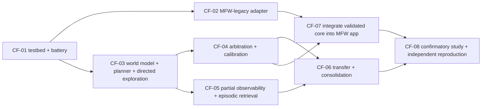

# Cognitive Milestone Roadmap

Part of the cognitive research package ([handbook](COGNITIVE_ARCHITECTURE_HANDBOOK.md)).

**Prioritisation.** Scientific value, dependency order, cost, the expected measurable improvement, then relevance to later manufacturing use. **Rules:**
- One scientific objective and one logically complete engineering outcome per milestone.
- One commit per milestone. A frozen gate specification may sit in its own commit before the gate run.
- No push without authorisation.

---

## CF-01 — Environment–agent separation and reproducible cognitive testbed

| Field | Content |
|---|---|
| Scientific objective | Establish a task battery in which knowledge is hidden and learned, and show that it discriminates model-based from model-free learning |
| Engineering outcome | `cognitive/testbed/` (environment, worlds, tasks, runner, statistics), `cognitive/agents/` (RANDOM, QL, DYNAQ, ORACLE), `cognitive/tests/`, `experiments/cf01/` (gate spec, driver, results) |
| File scope | New files only. No production, AC38, TC-2 or pinned-tree file is touched |
| Acceptance | Protocol §4: G1–G5; CF-01 PASS needs at least 2 of 3 tasks admitted |
| Unit/integration tests | Environment contract; statistics; CRN; isolation; mutants; agent update rules; task construction |
| Experiment | 20 `gate` worlds × E1–E3 × 4 agents (+ NAIVE arms in E1) |
| Baselines/ablations | RANDOM, QL, DYNAQ, ORACLE; the E1 NAIVE arm |
| Reproducibility | Seed domains; two identical runs; recorded hashes |
| Risks / rollback | Tasks may not discriminate: record PARTIAL, redesign the task in CF-01b, keep the infrastructure. Rollback = revert the new directories (no shared state) |
| Exit decision | PASS → CF-03 (and CF-02 in parallel). PARTIAL → CF-01b task redesign before CF-03. FAIL → fix the infrastructure first |

## CF-02 — MiniFlyWire-legacy adapter (characterisation, not improvement)

| Field | Content |
|---|---|
| Scientific objective | Place the existing agent on the battery with its privileged access declared |
| Outcome | An adapter that runs `main.js` headless against `GraphEnv` dynamics and rewards. Mode ORACLE-MAP is as shipped and is labelled privileged. Mode MAP-OFF needs a guarded production hook that disables L1–L4 and routes goal entry through the environment |
| File scope | `cognitive/agents/mfw_legacy/` (new); for MAP-OFF, a production hook of fewer than 15 lines, **only with explicit Director authorisation** |
| Acceptance | The adapter reproduces CF-00 BASE behaviour on `mfw-graph`. Battery results are reported with the privileged label |
| Risks | MFW owns its own start and episode structure, so it is hard to fit to reset/step. Mitigation: a step-level shim driven through `__M7_ENV__`, with start positions imposed by the shim |
| Exit | Results are descriptive. No improvement claim |

## CF-03 — Learned world model, planner and directed exploration (first new cognitive mechanism)

| Field | Content |
|---|---|
| Scientific objective | Show learned-model planning (C1, C2, C3, C6) that beats DYNAQ where a probabilistic model should matter |
| Outcome | `cognitive/agents/mbvi.mjs`: a Dirichlet transition model, a reward model, value iteration with a budget, and a count-based optimism bonus |
| Acceptance | Model unit tests (exact posterior); E1–E3 admitted against QL and against DYNAQ on a new gate domain; M1 better than uniform; M2 ECE ≤ 0.05 on stationary dev worlds |
| Tests | Value iteration against closed-form on small graphs; posterior-update properties; noisy-edge control |
| Baselines/ablations | QL, DYNAQ, MBVI without bonus, MBVI with budget 0 |
| Risks | Stochastic battery variants (p < 1) are needed to separate MBVI from DYNAQ; they are designed on dev worlds first |
| Exit | Admitted → CF-04/05. Not admitted → report it; the mechanism is not credited |

## CF-04 — Arbitration and metacognitive calibration

| Field | Content |
|---|---|
| Objective | C4 and C9: switch between MB and MF by reliability; calibrated confidence; budget control |
| Outcome | Arbitration module + monitor; E4 hidden-change task implemented |
| Acceptance | E4 admitted; ECE bound met; arbitration ablation hurts E4 and leaves E1 inside the equivalence margin |
| Risks | The COG-A P2 horizon failure. Calibrate the horizon on dev worlds first |

## CF-05 — Partial observability, history/belief and episodic retrieval

| Field | Content |
|---|---|
| Objective | C7 and D: memory becomes necessary |
| Outcome | E6 aliased-node tasks; a k-history baseline; an episodic store with cue retrieval and provenance; optionally a belief/EFE baseline |
| Acceptance | Memoryless fails; episodic beats k-history where the protocol predicts it; the context-mismatch control shows no effect |

## CF-06 — Structural transfer and consolidation

| Field | Content |
|---|---|
| Objective | C8: transfer of learned structure to an unseen related world |
| Outcome | World families; prior transfer; SR baseline; consolidation pass |
| Acceptance | E5 gain(F) − gain(F′) admitted |

## CF-07 — Integration into the MiniFlyWire application

| Field | Content |
|---|---|
| Objective | The app runs the validated core behind a flag. Visualization becomes a read-only subscriber |
| Outcome | Production change behind a flag; legacy agent unchanged when the flag is off |
| Acceptance | Flag-off byte-identity with the current gates (S-gates, G9); flag-on battery results equal the standalone core; no agent read from visual objects (static check) |
| Authorisation | Production edit; Director authorisation required |

## CF-08 — Confirmatory study and independent reproduction

| Field | Content |
|---|---|
| Objective | Confirm the headline capability claims on a fresh `confirm` domain |
| Outcome | A frozen, pushed protocol; the run; independent reproduction; report |
| Authorisation | Push and publication authorisation; reviewer designation |
