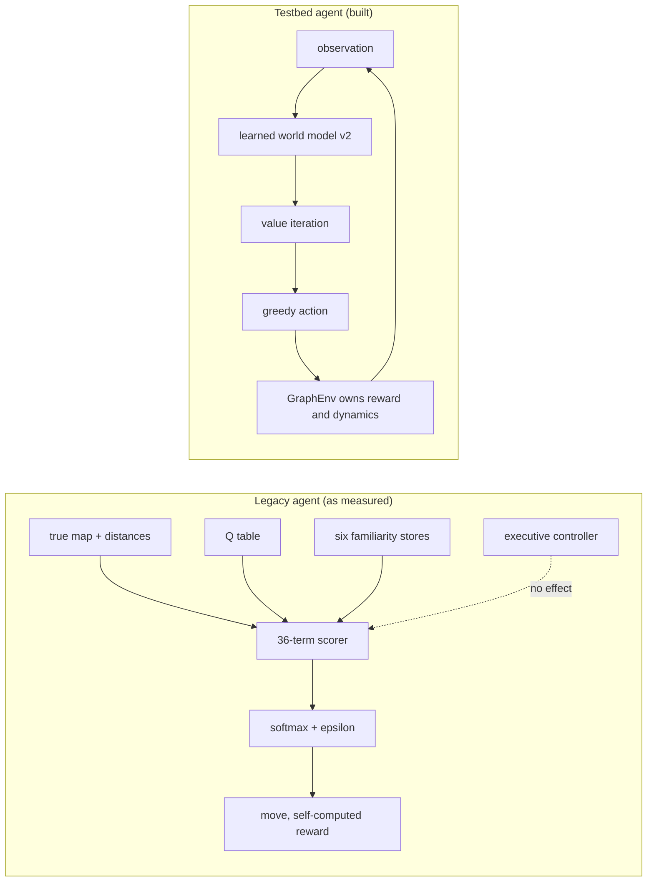
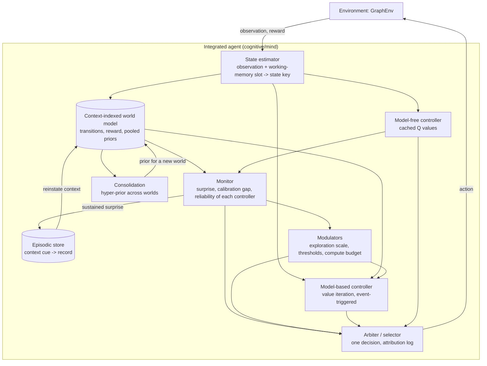
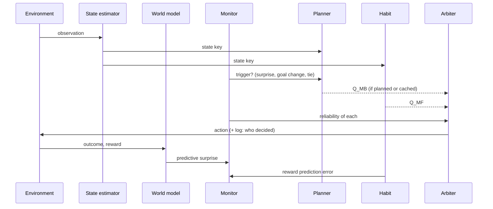
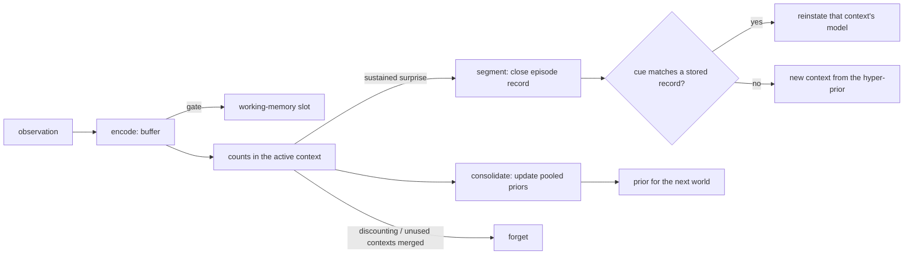
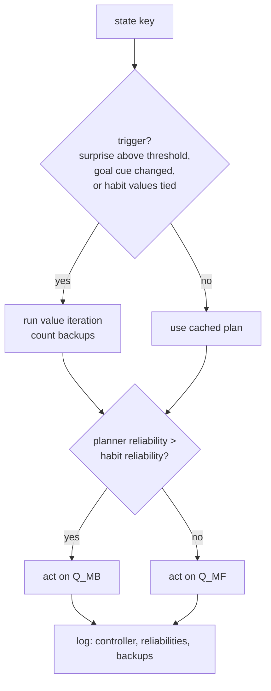
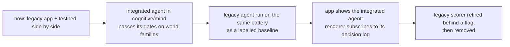

# MiniFlyWire Cognitive Architecture — target design

**Status:** design, version 1 (2026-11-13). Parts marked **built** have passed a gate; everything else is a
proposal with a hypothesis in [`HYPOTHESIS_REGISTRY.md`](../experiments/HYPOTHESIS_REGISTRY.md). The decisions and
the alternatives rejected are in [`ARCHITECTURE_DECISIONS.md`](ARCHITECTURE_DECISIONS.md).

This file also holds the sections asked for as separate deliverables: data flow (§4), memory (§5), decision and
control (§6), and the node and graph specification (§7).

## 1. What the system is today

Two systems live in this repository.

| | Legacy browser agent (`main.js`, `render/`) | Testbed agent (`cognitive/`) |
|---|---|---|
| World | One hand-authored 20-node graph; moves always succeed | Generated 24-node worlds; hidden reliabilities, blocks, reward location |
| What the agent sees | The true map, true distances, its own reward formula | `{node, nActions, goal}` and nothing else |
| Decision | Sum of about 36 heuristic terms, then a 60/40 blend with an arbitration score that changes 0 of 6,908 choices | Value iteration on a learned model (MBVI2), or Q-learning / Dyna-Q baselines |
| Evidence | Most named modules inert or duplicated ([audit](../COGNITIVE_AUDIT.md)) | Gates CF-01, CF-01b, CF-03b passed; CF-03 failed on calibration |

The legacy agent cannot be the base of a cognitive architecture, because it has no boundary between agent and
world: nothing it "learns" can be told apart from what it was given. The testbed has that boundary. **The target
architecture is therefore built in `cognitive/`, and the browser app becomes its visualiser** (decision AD-1).

## 2. Design principles

Each principle comes from the research streams in `docs/research/` and from this repository's own negative results.

1. **A module exists only if a task exists on which removing it lowers return.** The legacy system failed this for
   most of its modules. Tasks are admitted before the mechanisms that need them.
2. **Two complete controllers before any executive.** Arbitration is only measurable when two controllers with
   different error profiles can disagree. A controller that re-weights terms of one scorer has nothing to decide.
3. **One learned model is the single source of knowledge about the world.** In a stationary, fully observed world
   its counts are sufficient statistics, so separate "trust", "schema", "semantic" and "familiarity" stores are
   marginals of the same counts. They are not built.
4. **Probabilities must be calibrated before anything consumes them.** Arbitration, planning-on-demand and
   confidence reports all read the model's predictive probabilities. CF-03b established this.
5. **Internal variables modulate control; they never add to the action score.** Motivation-like and
   neuromodulator-like signals set exploration scale, thresholds and compute, where their effect can be clamped
   and measured.
6. **Every decision is attributable.** One selector, one log line per decision saying which controller decided.
7. **Dependency-free, tabular, consumer hardware.** Function approximation waits for a task that needs it.

## 3. Target architecture

| Subsystem | Responsibility | Inputs | Outputs | State it owns | Update | Status |
|---|---|---|---|---|---|---|
| State estimator | Turn an observation into the state key every other module uses | Observation; working-memory slot | State key | Working-memory slot (≤ 2), 1-step buffer | Every step | Trivial today (key = node label); needed under partial observability (H-WM) |
| World model | Predict the next state, reward and termination | State key, action, outcome | Predictive distributions; pooled priors μ, S, ν | Counts per pair; arrival statistics; per context | Every step | **Built** (v2, CF-03b); contexts proposed (H-CTX) |
| Model-based controller | Plan with the model | Model, state key, goal cue | Q values; backups used | Value cache per (context, goal) | On trigger (H-EVT); every step today | **Built** (plan every step) |
| Model-free controller | Cheap cached values | Transitions | Q values | Q table | Every step | Baseline agent exists (`agents/ql.mjs`); not yet inside the integrated agent |
| Monitor | Estimate how far each controller can be trusted | Model surprise; reward prediction errors | Reliability of each controller; change alarms; confidence | Running error averages | Every step | Proposed (H-ARB) |
| Arbiter / selector | Choose which controller acts; log the choice | Q values from both; reliabilities | One action; attribution record | Switch state | Every step | Proposed (H-ARB) |
| Modulators | Set exploration scale, thresholds, compute | Monitor signals; steps since reward | Control parameters | A few scalars | Every step | Proposed (H-MOD) |
| Episodic store | Recognise a regime seen before | Context cue; sustained surprise | Context to reinstate | Bounded ring of records with provenance | At event boundaries | Proposed (H-EPI) |
| Consolidation | Carry what is general to a new world | Model hyper-parameters | Prior for the next world | μ, S, ν per world family | Between worlds | The object exists (v2 hyper-parameters); transfer untested (H-XFER) |

**Shared state.** Each store has one writer (the table's "state it owns" column). Modules read each other only
through the interfaces above. No module reads the environment; the isolation tests enforce this.

**Complexity.** With S states and A actions per state: a model update is O(S·A) for the pooled refresh (about 60
pairs here); a value-iteration sweep is O(S·A); a decision costs k sweeps (measured: 6–28). The model-free
controller is O(A). Event-triggered planning is what makes the cost adaptive (§6).

**Failure handling.** If the model is unreliable (after a change, or early), the monitor's reliability for the
planner drops and the arbiter falls back to the model-free controller, and exploration scale rises. If both are
unreliable the agent explores. A module that throws is a test failure, not a runtime state: there is no silent
fallback.

**Persistence.** Within a world: all stores persist across episodes. Across worlds: only the consolidation prior.

## 4. Cognitive data flow

Information reaches a decision by exactly two routes (planner, habit), and the monitor decides between them. This
is the whole "integration" claim: it is testable because clamping any arrow in the diagram has a predicted effect.

## 5. Memory architecture

A memory is a store that changes a later decision. In a stationary, fully observed world the model's counts
already do that, so other stores add nothing. They earn a place only where the counts are not enough.

| Store | What it adds beyond the model | Pays off when | Operational test |
|---|---|---|---|
| World model (semantic knowledge of this world) | — | Always | Detour and relocation tasks (passed, CF-01b, CF-03b) |
| Pooled priors (knowledge general across pairs and worlds) | Faster, calibrated beliefs from few samples | Stochastic worlds; a new world of a known family | Calibration (passed, CF-03b); transfer to an unseen world (H-XFER) |
| Working memory (1–2 slots) | Information no longer in the observation | Partial observability: a cue seen earlier decides a later choice | Cue T-maze with delay sweep; must beat a k-step history at delays > k (H-WM) |
| Episodic store | Recognition of a regime that has occurred before | Non-stationary worlds that recur (A → B → A) | First episode after the return to A: matched retrieval beats mismatched (H-EPI) |
| Habit (Q values) | A cheap answer when the model is stale or planning is costly | Counted compute; a window where the model is wrong | Equal return at fewer backups; advantage in the stale-model window (H-ARB, H-EVT) |

Not built, with reasons: a successor-representation store (answers nothing value iteration cannot at this size;
kept as a diagnostic baseline), Hopfield or sparse distributed memory (exact keys make it a hash map), replay as a
separate system (it is planning under another schedule; the legacy replay effect was +0.1 [−8.1, 7.9]), and
separate "semantic", "schema", "trust" or "emotion" stores (marginals of the counts).

## 6. Decision and control architecture

**Chosen scheme: hybrid of event-triggered planning and reliability arbitration, through one selector.**

| Scheme considered | Verdict | Reason |
|---|---|---|
| Centralised executive re-weighting one scorer | Rejected | This is the legacy design; measured effect zero |
| Global-workspace broadcast, coalitions | Rejected as mechanism | No evidence in small agents; kept only as "one bottleneck with an attribution log" |
| Distributed competition among many modules | Rejected for now | Needs several complete controllers; there are two |
| Hierarchical control (options) | Deferred | No long-horizon task yet shows flat planning failing |
| **Reliability arbitration between a model-based and a model-free controller** | **Adopted** | The best-supported scheme for small agents; directly testable |
| **Event-triggered planning** | **Adopted** | Makes compute adaptive: plan on surprise, goal change or a tie, not every step |

- **Reliability** of the planner is one minus a running average of the model's predictive surprise; of the habit,
  one minus a running average of its absolute reward prediction error. Two averages, one threshold, a hard switch.
- **Metacognition** in this design is the monitor: it detects errors (surprise), estimates confidence (calibrated
  probabilities), and selects strategy (which controller, whether to plan). Nothing else is claimed under that word.
- **Resource-aware cognition** is the trigger: more computation when the situation is surprising or new, less when
  familiar. It is measured in backups per decision, not assumed.

## 7. Node and graph specification

**A node is a state of the environment: a place the agent can be.** It is not a neuron, and it is not a cognitive
function. Cognitive functions are the modules of §3. An edge is an action available at a node, with a hidden
probability of succeeding.

**The legacy graph.** 20 nodes named after cognitive functions ("percept", "recall", "decide"…) in five colour
groups, 39 undirected edges, hand-authored. The names do nothing: the agent walks the graph as a maze, and the
node called "recall" performs no recall. The graph is kept as the reference world `mfw-graph` and as the app's
visual identity. Its node names should be presented as place names.

| Question | Answer |
|---|---|
| Why change anything? | One 20-node graph cannot support claims about learning: every result so far describes seed replicates of a single topology |
| What replaces it? | World **families**, generated: 24 nodes today; 48, 96 and 200 next; then families with structure (rooms joined by bottlenecks, rings, trees, lattices) |
| New node properties | Observation aliasing (several nodes share one observation), cue nodes, per-edge reliability, edges that open or close over time |
| Dynamic and context-dependent connectivity | Yes, in the environment: regimes that switch edge sets and recur. This is what the context and episodic mechanisms are tested on |
| Inhibitory or competitive relationships | Not between nodes. Competition is between the two controllers (§6) |
| Hierarchical nodes | Deferred until a rooms-and-bottlenecks family shows flat planning failing; then options over bottleneck nodes |
| Complexity | Value iteration is O(S·A) per sweep: about 100 backups per sweep at 24 nodes, 800 at 200. Still milliseconds on a laptop |
| How tested | Every new family passes a task-admission gate (a planner must beat a habit learner on it) before any mechanism is credited there |

**A real connectome as a world.** The project's name refers to FlyWire, and the repository contains no connectome
data. A small published sub-circuit could be used as a world *topology*. That would make the graph real; it would
not make the agent a model of a fly brain. It is optional and changes no claim.

### Migration

No legacy file is deleted until step D has passed its own gate (flag-off byte-identity of the current app).

## 8. What this architecture does not claim

It is a small reinforcement-learning agent with a learned model, two controllers, a monitor and task-justified
memory. It is not a model of a brain, and nothing in it is conscious or human-like. Where a module is described
with a word from neuroscience (working memory, episodic, consolidation), the word names a computational role with
a stated test, and the analogy is an engineering inference, not established biology.
