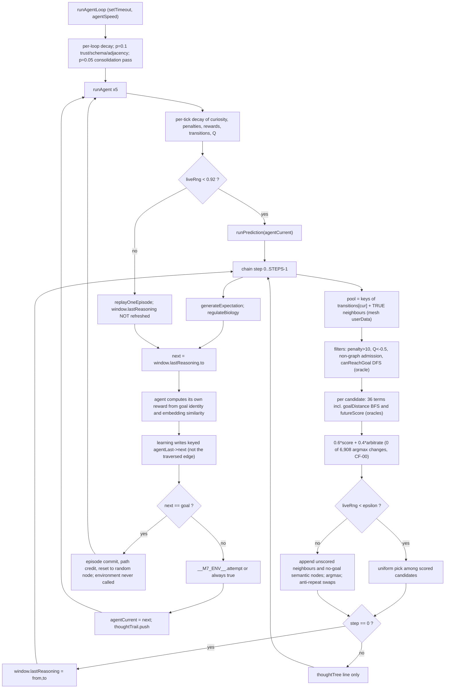
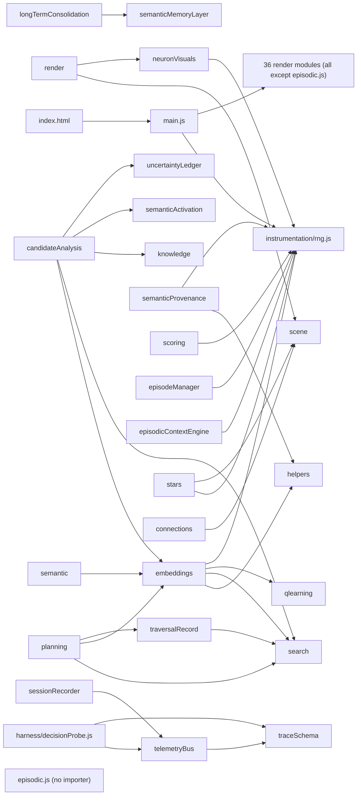

# MiniFlyWire legacy runtime: traced pipeline and call graph

Runtime-audit stream, 2026-11-13. Companion files: `docs/research/EXISTING_SYSTEMS_AUDIT.md` (classification, leak channels, defects D1-D15, channels O1-O12) and `docs/engineering/MODULE_DEPENDENCY_MAP.md`.

Scope: `index.html`, `main.js`, `render/*.js` (38 modules), `instrumentation/`, `benchmarks/harness/`, `neurons.json`, `connections.json`.

## 0. Method and limits

- Static reading only. Nothing was executed. Measured numbers are quoted from `experiments/cf00_audit/results/audit_summary.json` and marked [CF-00].
- `main.js` was read in full (lines 1-5699). Read in full or in their executable lines: `scoring.js`, `executiveController.js`, `candidateAnalysis.js`, `semantic.js`, `knowledge.js`, `memory.js`, `search.js`, `connections.js`, `qlearning.js` (key and update core), `trustMemory.js` (38-96), `emotionMap.js`, `planning.js` (211-397), `traversalRecord.js`, `longTermConsolidation.js` (42-160), `motivationalState.js` (197-362), `episodeManager.js` (57-132, 284-536, 911-1235), `instrumentation/rng.js` (30-95), `headlessShim.js` (84-150). For the other modules only top-level declarations, export lines and call sites were read; their internals are marked "not read" where it matters.
- **Call-graph method.** A read-only script (kept outside the repository) listed every `export function|const|let|class` in the 45 `.js` files and every column-0 `function` in `main.js`, then searched all in-scope files for each name with a word-boundary regex after removing comment lines. A hit inside an `import { … }` list counts as "imported", not as a call. Import edges were cross-checked with `grep -n "from ['\"]"`.
- Known weaknesses of the method: (a) generic names collide: `clear`, `dot`, `stars`, `animate`, `recordOutcome` produced false hits, which were resolved by hand and are noted below; (b) functions passed as references (`initEpisodeManager({...})`, `main.js:847-893`) are called through `_sys.*` inside `episodeManager.js`; those were traced by hand; (c) callers outside the scope (experiment drivers) are not counted, so "UNCALLED" means "no caller in scope".

## 1. Traced pipeline

### 1.1 Application and graph initialisation

| Step | Where | What happens |
|---|---|---|
| Page | `index.html:19`, `22` | three.js 0.158 from a CDN as a classic script (global `THREE`), then `main.js` as an ES module |
| Imports | `main.js:5-549` | 36 `render/` modules and `instrumentation/rng.js`. Module evaluation creates the scene (`render/scene.js:6-28`), the reasoning box (`render/ui.js:9`, `76`) and every module-level store |
| Visual setup | `main.js:553-559` | stars, group reference |
| Shared map | `main.js:566-576` | `neuronMap` (id → mesh) is handed to `search.js`, `embeddings.js`, `connections.js` |
| **Neuron creation** | `main.js:582-627` | `fetch('neurons.json')`; per record: `createFuturisticNeuron` (`:600`), then `userData = {isNeuron, id, label, cluster, type, neighbors: [], embedding: createEmbedding()}` (`:613-621`). `type` is absent from every record of `neurons.json` (20 nodes, 5 clusters) |
| Embedding pre-training | `main.js:632-644` | `trainEmbedding(a, b)` for every ordered pair related in `conceptRelations` (O8) |
| **Connection creation** | `main.js:647-667` | `fetch('connections.json')` (39 undirected edges; `confidence`, `rewardHistory`, `penaltyHistory` are all 1/0/0 and never read); per edge a visual line and `connectPoints`, which pushes each id into the other's `userData.neighbors` (`render/connections.js:120-125`) |
| Late wiring | `main.js:675` → `845-937` | `initEpisodeManager` with injected references, `initSchemaMemory`, `setConceptRelations`, `setEpisodeManagerBridge` |
| Brain restore | `main.js:1124` | `loadBrain()` runs at module top level, **before** the two fetches resolve |
| Goal injection | `main.js:1139` | `__M7_GOAL__` if present |
| Adjacency memory | `main.js:1146` | `rebuildAdjacencyMemory()` from restored episodes |
| Autosave | `main.js:1148` | `setInterval(saveBrain, 5000)` |
| Render loop, HUD | `main.js:3167-3183` | `animate()`, `createHUD()`, thinking stream, speed control |
| Agent start | `main.js:5321-5382` | Space toggles `agentRunning` and calls `runAgentLoop`; Shift+R wipes |

### 1.2 State initialisation and persistence

- Agent variables: `goalNeuronId` (`main.js:1042`), `agentRunning`, `agentSpeed = 500`, `agentCurrent`, `agentLast`, `loopId` (`main.js:3192-3204`), `lastDecision` (`:685`), `adjacencyMemory` (`:951`), `timeMemory` (`:1040`), `_m7EpisodeTicks` (`:1056`), `_mfwLedger` (`:1098`), diagnostics (`:3234-3245`).
- One storage key, `"brain"` (`main.js:740`, `756`, `5342`).

| Saved (`main.js:720-737`) | Restored (`main.js:794-821`) |
|---|---|
| `transitions`, `rewards`, `penalties`, `signals`, `curiosity`, `Q`, `confidence` | same, `transitions` with numeric keys, the rest string-keyed |
| `episodes` (`exportEpisodes()`) | `loadEpisodes` + `rebuildAdjacencyMemory` |
| `homeNeuronId`, `goalNeuronId` | same |

Not saved: trust counts, local emotion map, embeddings, attention focus, behaviour and drive states, consolidation registry, schemas, all uncertainty stores, semantic layers, traversal record, working memory. Shift+R clears the seven maps, episodes and the traversal record (`main.js:5342-5361`) but not trust, emotion, consolidation, schemas, embeddings or any other module store.

### 1.3 The loop

`runAgentLoop` (`main.js:5200-5316`), re-armed by `setTimeout(runAgentLoop, agentSpeed)`:

1. Per-loop decay: `decaySemanticActivations`, `decayTransitionUncertainties`, `decayUncertaintyLedger`, `decayActivations(0.93)`, `wmDecay` (`:5215-5228`).
2. With probability 0.1: `decaySemanticMemory`, `decayConsolidation`, `decayTrust(0.9997)`, `rebuildSchemas`, `rebuildAdjacencyMemory` (`:5231-5252`).
3. With probability 0.05: `runConsolidationPass` (`:5255-5257`).
4. Diagnostics every 20 loops (`:5281-5308`).
5. `runAgent()` five times (`:5310-5312`).

### 1.4 One tick: `runAgent` (`main.js:3249-5197`)

| Stage | Where | Real behaviour |
|---|---|---|
| Hooks, tick cap | `:3255-3299` | Only with M7 globals |
| Per-tick decay | `:3311-3389` | curiosity ×0.995 (p 0.1); `decaySemanticSystems`, `decayUncertainty` (p 0.15); penalties ×0.98, deleted below 0.05; rewards ×0.9995 (p 0.02); transitions ×0.995; Q ×0.999 (D6). These run even when the agent is stopped; the stop check is after them (`:3392`) |
| Start position | `:3395-3407` | Uniform over non-goal nodes, chosen by the agent (O10) |
| Home override | `:3426-3442` | `fatigueState > 80` and a home set → `goalNeuronId = home` |
| **Decide or replay** | `:3455-3479` | p 0.92: `runPrediction(agentCurrent)`. Else `replayOneEpisode()` and **no new decision** (D9) |
| Behaviour update | `:3488-3554` | `updateBehavior` from `lastDecision.best` (D8) |
| Explanation text | `:3557-3631`, `:3654-3941` | A second scoring formula for console and `reasoningBox` |
| Self-loop exit | `:3677-3685` | returns before learning or moving |
| **Reward** | `:3982-4088` | −2 if `agentLast === next` (unreachable, the block requires them to differ `:3967`); −0.3 beyond 8 repeats; 12 if `next` is the goal and the path window has ≥3 distinct nodes, else 0; else 2 / 0.3 / −0.4 by `sim` thresholds 0.45 / 0.15. Note the repeat penalty is overwritten by the `sim` branch assignment (`rewardSignal = …`, `:4056-4086`) |
| **Prediction error** | `:4127-4134` | `evaluatePredictionError`; null if no expectation is pending |
| Main branch | `:4144-4340` | Q update with rate `0.1 × learningAuthority`; transition and sequence error; `dampQ` when composite error > 0.20; semantic expectation, semantic and procedural ledgers, propagation; ε boost; emergency home goal; curiosity bump; behaviour modulation |
| Fallback branch | `:4342-4456` | Q update at 0.1; `recordSemanticEdge`; `reinforcePath` / `weakenPath`; attention focus; `boostActivation`; `updateUncertainty`; vitality; motivational `recordOutcome`; ε boost cleared |
| Trust attempt | `:4473-4480` | `recordAttempt(agentLast→next)` |
| Path window | `:4495-4503` | `recentMemory.push(next)`, max 6 |
| Curiosity count | `:4506-4548` | += 0.03 (+0.12 first time, +0.04 if rewarded), cap 5 |
| **Goal arrival** | `:4553-4677`, `:4717-4901` | Declared when `next` is the goal (O6): `recordAutonomousSuccess`; reward on `prev→goal`; for each consecutive pair of the window: `writeReward` +0.5, `confidenceMap` +5, `recordSuccess`. Then depth-scaled reward, stress relief, window cleared, `sealCurrentEpisode`, attention reset, activation boost, expectation reset, **agent re-placed at a random non-goal node** (`:4858-4862`), `lastDecision = null` |
| Penalty | `:4683-4692`, `:4905-4929` | +0.1 (cap 5) when reward < 0, and again when the display score is negative |
| Transition count | `:4703-4713` | `transitions[prev][current] += 1` only if a true edge |
| Signal, time stamp | `:4933-4942` | write-only stores |
| Episode step | `:4959-4961` | `recordAutonomousStep` (true edges only) |
| **Move** | `:4967`, `:4992-5063` | `agentLast = agentCurrent`; if `next` is the goal, nothing (already reset); else `__M7_ENV__.attempt(from, to)` or `true`; `recordTraversalOutcome`; on success `agentCurrent = next` |
| After the move | `:5083-5190` | `recordSemanticActivation`, fatigue +0.05, visuals, `thoughtTrail.push` (max 6) |

Every per-step write in rows "Main branch" to "Episode step" is keyed `agentLast→next` (D1).

### 1.5 One decision: `runPrediction` (`main.js:1519-3163`)

| Stage | Where | Real behaviour |
|---|---|---|
| **Perception** | `:1522`, `:1623-1640` | There is none. The agent reads the mesh of its node id: true neighbour list, embedding, label; plus its own stores. No observation object exists |
| Chain depth | `:1557-1619` | 4 (1 on a click), minus fatigue/confidence steps, plus 2 when unsure; clamped to 2..6 |
| No-goal semantic map | `:1664-1670` | `buildSemanticMap` over all other nodes when no goal |
| Drives | `:1689-1700` | `updateMotivationalState`, `computeExecutiveWeights`, `getMotivationalSnapshot` |
| **Candidate generation** | `:1709-1719` | Union of every key of `transitions.get(current)` and the true neighbours |
| Filters | `:1726`, `:1735-1738`, `:1763-1791`, `:1794-1796`, `:1804-1826` | penalty > 10; Q < −0.5; non-neighbour needs strength > 5 or (reward > 4 and an episodic witness); goal reachable within the depth-4 DFS (O2); `analyzeCandidate` (repeats two of these, rejects self) |
| **Memory retrieval** | `:1868-1873`, `:1897`, `:1924`, `:2027-2032`, `:2138-2155`, `:2296-2299`, `:2323`, `:2347-2351` | Point look-ups by edge key in `rewards`, `penalties`, `curiosityMap`, Q, emotion map, vitality, semantic layer, consolidation, trust, schema cache; one scan of all episodes for `trajectoryIntegrity` (`:989-1037`). No cue-based recall |
| **Attention** | `:2163-2167` | `applyAttentionAmplification(reward·3 + Q·2 + noise, embedding)` |
| **Prediction / planning** | `:1968-1991`, `:2053-2126` | `futureScore` depth-3 search on the true graph (O4), projected by `20·D/(D − FS)` with `D = graphDiameter()` recomputed per candidate; `goalDistance` BFS (O3) gated by `trajectoryConfidence` |
| **Scoring** | `:2183-2353` → `render/scoring.js:75-452` | 36 signed terms summed, clamped to ±400 (table below) |
| **Arbitration** | `:2367-2389` | `0.6 × score + 0.4 × arbitrate(...)` |
| **Selection** | `:2438-2490` | ε = clamp(0.2 − 0.002·fatigue + predBoost + stressBoost, 0.02, 0.7); with probability ε a uniform pick among scored candidates; sort by weight |
| Secondary pools | `:2540-2612` | Unscored true neighbours (weight = similarity) and, without a goal, semantic-map nodes (weight = similarity × 2), both filtered by `conceptRelations` (D10) |
| "Softmax" | `:2616-2650` | Probabilities computed; top 1-3 kept; **no sampling** |
| Final pick | `:2713-2736` | explore choice, else arg-max; swapped for the runner-up if it equals the current node or the node two steps back |
| **Execution hand-off** | `:2764-2769` | step 0 only: `window.lastReasoning = {from, to}` |
| HUD | `:2780-2833` | step 0 only |
| Chain | `:2839-2850` | `currentKey = nextKey`; repeat |
| Behavioural regulation | `:2884-2992` | `regulateBiology({activity, mentalLoad: STEPS, repetition, loopDepth, danger, isHome})` |
| Expectation | `:3116-3160` | `generateExpectation` for `lastReasoning` |

### 1.6 The decision score

`score = clamp(Σ terms, −400, 400)` (`render/scoring.js:386-387`, `451`). `exploitW` and `exploreW` are always 1 (D2). `damp = 1 − min(0.5·uncertaintyScore, 0.4)` (`scoring.js:315-316`). `semW = max(0.08, 0.35 − 0.02·reward)` (`scoring.js:193-195`). Flip = CF-00 knockout flip rate, goal 16 / no goal.

| # | Term (`scoring.js` line) | Formula | Source variable (computed at) | Flip |
|---|---|---|---|---|
| 1 | `transitionBoost` (335) | ×3 | `log1p(transitions[cur][k])·1.8` (`main.js:1932-1943`) | 0.30% / 2.22% |
| 2 | `qValue` (336) | ×5 | `getQ(pos#goal, k)` (`main.js:1924`) | 1.85% / 1.44% |
| 3 | `reward` (337) | `tanh(0.1·r)·8` | `rewards[cur→k]` (`main.js:1868`) | 0.03% / 0.89% |
| 4 | `habitBoost` (338) | ×2 | `log(visits+1)·3`, visits = `curiosityMap[cur→k]` (`main.js:1873-1883`) | 0.09% / 0.40% |
| 5 | `curiosityBoost` (340) | ×2 | `0.08/√(visits+1)` (`main.js:1878-1879`) | 0 / 0 |
| 6 | `chainReward` (342) | ×4 | constant 0 (`main.js:1960`) | 0 |
| 7 | `meaningBoost` (344) | × semW × damp | `analyzeCandidate` × 0.15 (`main.js:2199`) | 0.01% / 0.40% |
| 8 | `semanticVitalityScore` (345) | ×1.2 × damp | `getSemanticSignal` (`main.js:2138-2139`) | 0.06% / 0.01% |
| 9 | `noiseSuppressedScore` (346) | ×1 | `getNoiseSuppressedScore` (`main.js:2148-2153`) | 0.06% / 0.04% |
| 10 | `consolidationBonus` (347) | ×2 | `getConsolidationScore` (`main.js:2155`) | 0.07% / 0.14% |
| 11 | `attentionAmplifiedScore` (348) | ×0.4 | `main.js:2163-2167` | 1.09% / 2.63% |
| 12 | `futureBonus` (350) | ×1.2 | `main.js:1970-1991` | 0.22% / 0 |
| 13 | `goalGradientBoost` (352) | ×2 | `main.js:2053-2126`: goal candidate `100·tc`; else `(22.5/(dist+0.5)+5)·(0.1+0.9·tc)`; unreachable −8·(…) | 2.81% / 0 |
| 14 | `driveGoalBoost` (353) | 4 if drive is "stress" and gradient > 0 | `scoring.js:285-287` | 0 / 0 |
| 15 | `schemaBonus` (355) | ×15 | `getSchemaBonus` (`main.js:2323`) | 0.16% / 0 |
| 16 | `trajectoryIntegrity` (356) | ×40 | `computeTrajectoryIntegrity` (`main.js:2347-2351`) | 0.35% / 0 |
| 17 | `trustBonus` (358) | `(trust − 0.5)·8·1.5` | `getPathTrust` or the M7 arm (`main.js:2296-2299`) | 1.00% / 0.39% |
| 18-22 | `localConfidence` ×1.5, `localTrust` ×1.2, `localStress` ×−1.4, `localFatigue` ×−1.1, `localFear` ×−2.2 (360-364) | | `getLocalEmotion(startKey, k)` (`main.js:2027-2032`, `2227-2231`) | ≤0.10% each |
| 23 | `driveRewardBoost` (366) | `tanh(0.1·r)·3` if drive is "hunger" | `scoring.js:281-282` | 0 / 0.04% |
| 24 | `driveCuriosityBoost` (367) | `curiosityBoost·1.5` if "boredom" | `scoring.js:283-284` | 0 / 0 |
| 25 | `boredomPenalty` (369) | ×−2 | `visits·0.25` (+0, D3) (`main.js:1916-1921`) | 0.03% / 0.08% |
| 26 | `repetitionPenalty` (370-372) | `−(p+1)^2.5·2.5` = −38.97 when p = 2 | 2 if k is among the last 3 of `thoughtTrail` (`main.js:2003-2019`) | 0.49% / **10.10%** |
| 27 | `curiosityState` (374) | ×0.8 | `behavior.js` | 0, candidate-constant |
| 28 | `confidenceState` (375) | `min(c, 20)·0.5` | `behavior.js` | 0, constant |
| 29 | `stressState` (376) | ×−0.4 | `behavior.js` | 0, constant |
| 30 | `fatigueState` (377) | ×−0.35 | `behavior.js` | 0, constant |
| 31 | `fatigueOverload` (378) | `−max(0, f − 140)·0.5` | `behavior.js` | 0, always 0 |
| 32 | `dynamicFocus` (379) | ×−0.25 | `scoring.js:239-260` | 0.07% / 0.28% |
| 33 | `dangerPenalty` (380) | ×−2 | `penalties[cur→k]·1.5` (`main.js:1994-1995`) | 0 / 0.01% |
| 34 | `selfLoopPenalty` (381) | −1000 if k = cur | unreachable | 0 |
| 35 | `repetitionFatigue` (382) | `−max(0, q − 2)·1.2` | `scoring.js:202-203` | 0.07% / 0.01% |
| 36 | `drift` (383) | `−(rng − 0.5)·curiosityState·0.06` | `scoring.js:210-213` | 0.06% / 2.40% |

Accepted and unused: `focusState`, `uncertaintyState`, `transitionUncertainty`, `sequenceError`, and the spread procedural-ledger fields (`scoring.js:100`, `167-170`). `uncertaintyScore` and `dominantDrive` are used; `executiveWeights` is read under absent names.

### 1.7 Consolidation, regulation, long-term adaptation

| Process | Trigger | Where |
|---|---|---|
| Episode pipeline (`_learnProcedural`, `_learnSemantic`, `_updateTrust`, `_storeEpisode`, `_maybeConsolidate`) | sealed manual, success or replay episode | `episodeManager.js:820-1235`: transitions +20·gain, Q update with reward 8·gain·(1+bonus), `writeReward`, momentum, trust success, `confidenceMap`, motif `reinforcePath`, schema rebuild |
| Replay | 8% of ticks, 4 s wall-clock cooldown per path | `episodeManager.js:430-528` (Q under the no-goal namespace) |
| Schema rebuild | 10% of loops and every 20 stored episodes; 15 s throttle | `main.js:5247`; `episodeManager.js:1143-1151`; `schemaMemory.js:129-134` |
| Reward upkeep of stable paths | 5% of loops | `longTermConsolidation.js:101-121` |
| Decay | per tick and per loop | §1.3, §1.4 |
| Behavioural regulation | per decision, per tick, per move | `regulateBiology` (`main.js:2952`), `updateBehavior` (`:3539`), `applyPredictionErrorToBehavior` (`:4331`), `changeFatigue` (`:5103`), `changeStress` (`:4801`). Internals of `behavior.js` not read |
| Long-term adaptation | — | Only what `localStorage["brain"]` carries across sessions (§1.2). No structural change to the graph, the score weights or the module set occurs at run time |

### 1.8 The real decision loop

## 2. Call graph

### 2.1 Top-level functions of `main.js`

| Function | Line | Callers |
|---|---|---|
| `saveBrain` | 709 | `main.js:1148` (interval) |
| `loadBrain` | 754 | `main.js:1124` |
| `_initEpisodeManagerWhenReady` | 845 | `main.js:675` |
| `rebuildAdjacencyMemory` | 953 | `main.js:812`, `1146`, `5251` |
| `trajectoryConfidence` | 964 | `main.js:2102`, `2122`, `4749` |
| `computeTrajectoryIntegrity` | 989 | `main.js:2347` |
| `_mfwTrajectorySupport` | 1100 | `main.js:4048` (guarded) |
| `canReachGoal` | 1153 | `main.js:1794`, `2542`; passed at `:1818` and called at `render/candidateAnalysis.js:144` |
| `projectFutureScore` | 1250 | `main.js:1991` |
| `graphDiameter` | 1277 | `main.js:1991` |
| `goalDistance` | 1317 | `main.js:2067` |
| `pruneGoalWraparound` | 1401 | `main.js:5525` |
| `runPrediction` | 1519 | `main.js:3457`, `5651` |
| `runAgent` | 3249 | `main.js:5311` |
| `runAgentLoop` | 5200 | `main.js:5314`, `5375`; captured by name at `benchmarks/harness/headlessShim.js:135` |
| anonymous handlers | 5321, 5393 | `keydown`, `click` events |
| exports `_diagVisits`, `_diagLoops`, `_diagCounters` | 3234-3241 | no importer in scope; `_diagCounters` used at `main.js:910`, `4174`, `4355`, `5281-5289` |

None is uncalled.

### 2.2 Exported functions of `render/*.js`

`M:n` = `main.js` line n. "via sys" = called through the reference object injected at `main.js:847-893`.

| Module | Export (line) | Callers |
|---|---|---|
| `activationCompetition.js` | `setActivation` (18) | internal `:29` only |
| | `boostActivation` (27) | M:4402, M:4831 |
| | `decayActivations` (32) | M:5227 |
| | `computeLateralInhibition` (40) | internal `:63` only |
| | `getCompetitionScore` (62), `setContextMask` (67), `clearContextMask` (68), `isContextEligible` (69), `getActivationVolatility` (73), `getActivation` (81), `getTopActiveNeurons` (83) | **UNCALLED** |
| `behavior.js` | `changeFatigue` (38) | M:5103, M:5113, M:5684 |
| | `changeStress` (52) | M:4801 |
| | `regulateBiology` (105) | M:2952 |
| | `updateBehavior` (353) | M:3539 |
| | `applyPredictionErrorToBehavior` (616) | M:4331 |
| `candidateAnalysis.js` | `analyzeCandidate` (77) | M:1804 |
| `cognitiveAttention.js` | `updateAttentionFocus` (49) | M:4392 |
| | `setGoalAttention` (89) | M:5513 |
| | `getAttentionScore` (116) | internal `:133` only |
| | `applyAttentionAmplification` (131) | M:2167 |
| | `strengthenAttention` (149) | M:4396 |
| | `weakenAttention` (161) | M:4398 |
| | `resetAttentionFocus` (173) | M:4828 |
| | `getAttentionSnapshot` (194) | M:3905 |
| `connections.js` | `setConnectionNeuronMap` (38) | M:576 |
| | `connectPoints` (51) | M:666 |
| `embeddings.js` | `setEmbeddingNeuronMap` (88) | M:573 |
| | `createEmbedding` (101) | M:620 |
| | `trainEmbedding` (153) | M:641; via sys `episodeManager.js:1044` |
| | `similarity` (340) | M:2560, M:3126, M:3655; `candidateAnalysis.js:197`; `planning.js:113`; `semantic.js:62`; internal |
| `emotionMap.js` | `getLocalEmotion` (33) | M:2029; internal `:87` |
| | `updateLocalEmotion` (74) | M:4096 |
| `episodeManager.js` | `initEpisodeManager` (183) | M:847 |
| | `recordManualClick` (211) | M:5453 |
| | `recordAutonomousSuccess` (284) | M:927 (bridge), M:4590 |
| | `recordAutonomousStep` (365) | M:4960 |
| | `replayOneEpisode` (430) | M:3478 |
| | `getAllEpisodes` (549) | M:744, M:826, M:955, M:991, M:2802, M:5247, M:5305 |
| | `clearAllEpisodes` (568) | M:5353 |
| | `exportEpisodes` (627) | M:732 |
| | `loadEpisodes` (644) | M:810 |
| | `getEpisodesForBuildMap` (538), `getEpisodeStats` (554), `getActiveGoalCoverage` (593) | **UNCALLED** |
| `episodic.js` | `buildEpisodeMap` (14) | **UNCALLED** (module not imported) |
| `episodicContextEngine.js` | `setEpisodeManagerBridge` (72) | M:924 |
| | `wmAddNode` (130) | internal `:288` only (inside uncalled `episodeRecordNode`) |
| | `wmDecay` (166) | M:5228 |
| | `wmGetSnapshot` (201) | internal `:542` only |
| | `sealCurrentEpisode` (338) | M:3271, M:4822; internal |
| | `setConceptRelations` (431) | M:917 |
| | `rewardCurrentEpisode` (503) | M:4825 |
| | `getCurrentEpisodeState` (533) | M:3904, M:5303 |
| | `wmGetActivation` (189), `episodeRecordNode` (283), `isLearningGated` (491), `getEpisodeVaultForReplay` (516), `resetManualSession` (554), `getEpisodesByTag` (583), `getVaultSize` (594) | **UNCALLED** |
| `executiveController.js` | `arbitrate` (135) | M:2371; `benchmarks/harness/decisionProbe.js:43-44` |
| | `explainArbitration` (288) | **UNCALLED** |
| `helpers.js` | `normalize` (11) | `embeddings.js:114`, `236-237`, `320` |
| | `dot` (60) | `embeddings.js:343` |
| | `growReward` (104) | `semanticProvenance.js:126` |
| `hud.js` | `createHUD` (117) | M:3174 |
| | `updateHUD` (140) | M:2786, M:5600 |
| | `createThinkingStream` (265) | M:3177 |
| | `updateThinkingStream` (299) | M:2816 |
| | `createSpeedControl` (367) | M:3178 |
| `longTermConsolidation.js` | `reinforcePath` (42) | M:4379; via sys `episodeManager.js:1193` |
| | `weakenPath` (75) | M:1455 (wrong arity, D4), M:4387 |
| | `runConsolidationPass` (101) | M:5256 |
| | `getConsolidationScore` (140) | M:2155 |
| | `decayConsolidation` (162) | M:5233 |
| | `getConsolidationSummary` (184) | M:2803, M:3907 |
| | `isStableMemory` (128) | **UNCALLED** |
| `momentumMemory.js` | `learnMomentum` (26) | via sys `episodeManager.js:1019` |
| | `getMomentumBonus` (95) | **UNCALLED** |
| `motivationalState.js` | `recordOutcome` (62) | M:4448 |
| | `updateMotivationalState` (95) | M:1689 |
| | `computeExecutiveWeights` (197) | M:1698 |
| | `getMotivationalSnapshot` (309) | M:1700, M:2801, M:3902 |
| `neuronVisuals.js` | `setVisualsGroup` (37) | M:559 |
| | `createFuturisticNeuron` (136) | M:600 |
| | `createFuturisticConnection` (216) | M:663 |
| | `tickNeuronPulse` (257) | `render.js:46` |
| | `flashNeuronClick` (302) | M:5426 |
| | `spawnTravelDot` (353) | M:2705, M:5178 |
| | `setAttentionSpotlight` (456) | M:2826 |
| | `setNeuronHighlight` (486) | M:5422, M:5427, M:5432 |
| | `getNeuronCluster` (517) | **UNCALLED** |
| `planning.js` | `futureScore` (283) | M:1971 |
| | `lookAheadScore` (50) | **UNCALLED** |
| `predictionError.js` | `generateExpectation` (82) | M:3137 |
| | `evaluatePredictionError` (120) | M:4127 |
| | `getRollingError` (434) | M:4595 |
| | `resetExpectation` (454) | M:3283, M:4840 |
| | `updateTransitionUncertainty` (510) | M:4182 |
| | `getTransitionUncertainty` (578) | M:2260, M:4338 |
| | `updateSequenceError` (624) | M:4191, M:4451 |
| | `getSequenceError` (647) | M:2268, M:4339 |
| | `recordSemanticExpectationOutcome` (682) | M:4241 |
| | `decayTransitionUncertainties` (723) | M:5220 |
| | `peekTransitionUncertainty` (568), `getSemanticExpectationConfidence` (705) | **UNCALLED** |
| `qlearning.js` | `makeStateKey` (40) | M:1735, M:1924, M:2793, M:2810, M:3892, M:4168-4171, M:4220, M:4349-4352, M:4415, M:5590, M:5658; via sys `episodeManager.js:1000-1001`; passed to schema memory M:909 |
| | `getQ` (58) | M:1735, M:1924, M:2793, M:2810, M:3892, M:4415, M:5590, M:5658; internal `:173`; passed to schema memory M:908 |
| | `getQAny` (91) | `embeddings.js:199-200`, `293-299` |
| | `updateQ` (143) | M:4167, M:4348; via sys `episodeManager.js:1003` |
| | `dampQ` (319) | M:4219 |
| | `setQ` (126) | internal `:252` only |
| `render.js` | `setStars` (26) | M:556 |
| | `animate` (35) | M:3167; self (frame loop). The hits in `neuronVisuals.js:386-444` are a local function of the same name |
| `schemaMemory.js` | `initSchemaMemory` (116) | M:898 |
| | `rebuildSchemas` (129) | M:5247; via sys `episodeManager.js:1149`, `1224` |
| | `getSchemaBonus` (256) | M:2323, M:2510 |
| | `getSchemas` (269), `getSchemaDiagnostics` (290) | **UNCALLED** |
| `scoring.js` | `calculateDecisionScore` (75) | M:2185; `benchmarks/harness/decisionProbe.js:39` |
| `search.js` | `setNeuronMap` (16) | M:570 |
| | `findNeuronById` (28) | 53 external references: `main.js`, `candidateAnalysis.js:163`, `embeddings.js`, `planning.js:261`, `340`, `traversalRecord.js:75`; via sys in `episodeManager.js` |
| `semantic.js` | `buildSemanticMap` (27) | M:1666 (no-goal branch) |
| `semanticActivation.js` | `recordSemanticActivation` (102) | M:4252, M:5088 |
| | `getSemanticActivationFactor` (134) | `candidateAnalysis.js:268` |
| | `decaySemanticActivations` (162) | M:5215 |
| | `getActivationStrength` (191) | **UNCALLED** |
| `semanticMemoryLayer.js` | `recordSemanticEdge` (46) | M:4369; `longTermConsolidation.js:66` |
| | `getSemanticEdgeStrength` (106), `getSchemaStrength` (140) | internal `:163-164` only |
| | `getNoiseSuppressedScore` (161) | M:2148 |
| | `decaySemanticMemory` (185) | M:5232 |
| | `getSemanticSummary` (225) | M:3906 |
| | `isNoiseEdge` (123) | **UNCALLED** |
| `semanticProvenance.js` | `getProvenanceAuthority` (98) | internal only |
| | `writeReward` (117) | M:4647; via sys `episodeManager.js:1013` |
| | `logActivation` (173) | M:4648; via sys `episodeManager.js:1014` |
| | `writeTransition` (146), `getActivationDominance` (205), `shouldTrainEmbedding` (239) | **UNCALLED** |
| `semanticVitality.js` | `reinforceSemanticStrength` (66) | via sys `episodeManager.js:1066`; internal `:297` |
| | `activateSemanticVitality` (107) | M:4430 |
| | `decaySemanticSystems` (150) | M:3326 |
| | `penalizeSemanticPath` (195) | M:4437 |
| | `getSemanticSignal` (229) | M:2139, M:3923 |
| | `reinforceEpisodeSemantics` (279) | via sys `episodeManager.js:1057` |
| | `getSemanticStrength` (259), `getSemanticVitalityLevel` (265) | **UNCALLED** |
| `stars.js` | `createStars` (31) | M:553 |
| `traversalRecord.js` | `recordOutcome` (103) | M:5059 (as `recordTraversalOutcome`) |
| | `recordFor` (139) | `planning.js:231` |
| | `clear` (157) | M:5357 (as `clearTraversalRecord`) |
| `trustMemory.js` | `recordAttempt` (43) | M:4478 |
| | `recordSuccess` (63) | M:4675; via sys `episodeManager.js:1092` |
| | `getPathTrust` (87) | M:2298-2299; internal `:179` |
| | `getTrustUncertainty` (112) | internal `:180` only |
| | `decayTrust` (141) | M:5244 |
| | `getTrustSnapshot` (171) | **UNCALLED** |
| `uncertaintyEngine.js` | `updateUncertainty` (67) | M:4417 |
| | `getUncertaintyScore` (148) | M:2176, M:3926 |
| | `getGlobalUncertaintyPressure` (219) | internal `:274` only |
| | `decayUncertainty` (242) | M:3327 |
| | `getPredictionCalibration` (194), `getUncertaintySnapshot` (270) | **UNCALLED** |
| `uncertaintyLedger.js` | `updateProceduralUncertainty` (207) | M:4267 |
| | `getProceduralUncertainty` (226) | M:2276; internal `:470` |
| | `updateSemanticUncertainty` (247) | M:4249 |
| | `getSemanticUncertainty` (262) | internal `:478` only |
| | `propagateUncertainty` (343) | M:4270 |
| | `decayUncertaintyLedger` (408) | M:5224 |
| | `getCombinedSemanticUncertainty` (476) | `candidateAnalysis.js:271` |
| | `registerOllamaPair` (294), `getCombinedUncertainty` (468), `getLedgerSummary` (488) | **UNCALLED** |

`knowledge.js`, `memory.js`, `scene.js`, `ui.js` export data only. 38 exported functions have no caller in scope (the 37 marked UNCALLED above, counting grouped rows individually, plus `episodic.buildEpisodeMap`); the exact tally by hand is 39 including `getActivationVolatility`, so treat "38-39" as the count and the table as the authority.

### 2.3 Non-`render/` exports

| File | Export | Callers in scope |
|---|---|---|
| `instrumentation/rng.js` | `liveRng` (89) | `main.js` (11 sites), `embeddings.js:110`, `episodeManager.js:473`, `653`, `789`, `episodicContextEngine.js:120`, `scoring.js:211`, `semanticProvenance.js:244-245`; `neuronVisuals.js`, `stars.js` (sites not listed) |
| | `makeRng` (17), `initRng` (32), `rng` (51), `cognitiveRng` (59), `visualRng` (60), `isSeeded` (85) | none in scope (drivers are outside it) |
| `instrumentation/telemetryBus.js` | `subscribe` (27) | `sessionRecorder.js:24` |
| | `emit` (36) | `decisionProbe.js:60` |
| | `configureBus`, `isEnabled`, `resetBus` | none in scope |
| `instrumentation/traceSchema.js` | `makeEnvelope`, `validateEnvelope` | `telemetryBus.js:38-39` |
| | `CHANNELS`, `TYPES` | `decisionProbe.js:62-63` |
| `instrumentation/sessionRecorder.js` | `createRecorder` (20) | none in scope |
| `benchmarks/harness/decisionProbe.js` | `probeDecision` (28) | none in scope |
| `benchmarks/harness/headlessShim.js` | `installThreeStub`, `installDomStub`, `installFetchStub`, `installTimerControl`, `settle` | none in scope |

## 3. Module import graph

Edges are static `import` statements (full table with lines: `docs/engineering/MODULE_DEPENDENCY_MAP.md` §1). There is no dynamic `import()` of a project module in scope.

**Circular imports: none.** Every edge above points from a higher layer to a lower one (`main` → feature modules → `embeddings`/`planning` → `search`/`helpers`/`qlearning`/`traversalRecord` → nothing). The cycles that would exist are avoided by injection instead of import: `episodeManager.js` receives 13 functions and maps through `initEpisodeManager` (`main.js:847-893`; the comment at `:888-890` names the avoided cycle with `schemaMemory.js`), `schemaMemory.js` receives `getQ`, `makeStateKey` and the visit map (`main.js:898-911`), `episodicContextEngine.js` receives a bridge callback (`main.js:924-933`), and `candidateAnalysis.js` receives `canReachGoal` as an argument (`main.js:1818`). These are real run-time dependencies that the import graph does not show.

`decisionProbe.js` also calls `calculateDecisionScore` and `arbitrate` (`:39-44`); its import lines for those two were not captured by the extractor and were not read: not determined whether it imports them or receives them.
