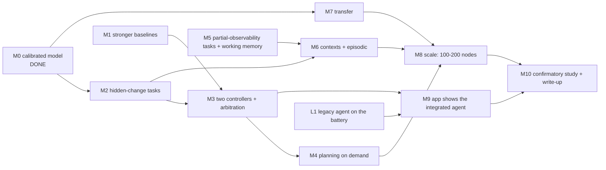

# Implementation Roadmap

From the current state to an integrated, measured agent shown in the app. It supersedes the ordering of
CF-04…CF-08 in [`COGNITIVE_MILESTONE_ROADMAP.md`](../COGNITIVE_MILESTONE_ROADMAP.md) where the two differ; that
file remains the record of results. Hypotheses are defined in
[`HYPOTHESIS_REGISTRY.md`](../experiments/HYPOTHESIS_REGISTRY.md).

**Rules for every milestone.** One scientific objective. Design on `dev`, freeze the gate spec in its own commit,
run once on an unused domain, record the result whatever it is. `npm test` and the legacy gate stay green. One
commit for the frozen design, one for the result. No push without the owner's word.

## Status against evidence (2026-11-17)

The capability targets, in the owner's order of priority (Decision 8), and where the evidence stands. They are
research targets, not modules to add.

| Capability | Evidence so far | State |
|---|---|---|
| 1. World modelling and prediction | Learned model with pooled priors beats a per-pair rule where exits are alike, loses where they are spread wide (CF-03c) | **Partial**; calibrated on the development generator only |
| 2. Learning and planning | Value iteration on the learned model beats Dyna-Q, Dyna-Q+ and Q-learning on every task so far (CF-01…CF-05b) | **Established on 24-node worlds** |
| 3. Change detection and adaptation | Removing change detection costs +161 steps after a block (CF-04) | **Established** |
| 4. Recovery and memory | RECALL recovers two-thirds of the gap after a reversal, costs 7.7 when the change is permanent (CF-05b); blanket re-testing fails (CF-05 closure). A two-regime belief per changed exit, with ρ fixed at 1/2, beats each of four fixed re-testing policies over a mix of reversal rates: about 28 steps a run (2.4%) against the planner, and it costs 17.4 a run where changes rarely reverse (CF-06) | **The belief adopted (AD-13)**, with a limited claim; RECALL not adopted |
| 5. Uncertainty and confidence | Calibration error cannot tell the model from a constant forecaster (CF-03c); Brier with decomposition replaces it | Open |
| 6. Metacognition and self-evaluation | Reliability arbitration between two controllers harmful at this scale (CF-04). Learning how often changes reverse beat ρ = 1/2 by 11.3 [0.3, 22.8], but task E5 failed its headroom rule (CF-06) | Not supported in the arbitration form. Learning how volatile the world is (H-VOL) is not admitted by E5; the adopted belief fixes ρ |
| 7. Generalisation | Same sign and break-even at 48 nodes (CF-05b, non-gating); calibration fails on 3 of 4 unseen reliability families | Partial |
| 8. Integration and efficiency | One agent: the planner on model v6 with ρ fixed at 1/2 (AD-13), with about 7% more work per decision than MBVI3, which stays the baseline. Research prototypes sit beside it | The belief is integrated into the testbed agent; nothing is in the browser app |

| Milestone | State |
|---|---|
| M0 / M0b calibrated model | Done; claim narrowed to the development generator (CF-03b, CF-03c) |
| M2 hidden-change task | Done (E4, CF-04); extended with a permanent-change arm (E4B) |
| M3 arbitration | Tested, not supported; withdrawn at this scale (CF-04) |
| CF-05 exploration bonus | Closed without a gate as a development-level negative finding |
| CF-05b targeted recall | **Done: SUPPORTED AT A COST; not adopted** |
| CF-06 belief about whether a change reverses | **Done: SUPPORTED — CONSISTENT; adopted (AD-13).** Learning the rate is not admitted by E5 |
| M1 stronger baselines | Partly done: Dyna-Q+ with a count model built and used |
| M4, M5, M6, M7, M8, L1, M9, M10 | Unchanged below; M5/M6 still need their tasks admitted first |

### CF-06 — learning how often changes reverse (as first planned)

**Status (2026-11-17).** Run as a test of the belief with ρ fixed at 1/2, the owner's re-scope: SUPPORTED —
CONSISTENT, and adopted (AD-13). Learning the rate (H-VOL) was reported, not tested, because E5 failed its headroom
rule. The table below is the plan as first written.

| | |
|---|---|
| Objective | H-VOL: an agent that learns from its own experience how often changes reverse, and re-tests only where that pays |
| Existing problem | RECALL fixes its willingness to re-test in advance; CF-05b shows the right value depends on the world (helpful above p ≈ 0.35, harmful below) |
| Mechanism | Inside the world model, not beside it: when a change is declared, keep the earlier regime of that exit; plan with a belief over the two regimes; learn the switching rate from how often past declared changes turned out to reverse, pooled across exits like the move prior |
| Task (to admit first) | Several changes per run on different route edges; each reverses with a probability set per world family (for example 0, 0.5 and 0.9). The task is admitted if the best fixed-rate agent differs between families |
| Baselines | MBVI3 (never re-tests); RECALL at fixed rates (the CF-05b settings); an oracle that knows the family's true rate |
| Acceptance (to freeze) | The learning agent is no worse than the best fixed rate in every family, and better than any single fixed rate across families |
| Cost | About 2–4 days to build and admit the task, then one gate |
| Risk | Too few changes per run to learn a rate; then the rate must be carried across worlds (ties to M7 transfer) |

The diagram below is the plan as first written and is kept for the record; the table above governs.

## What can run in parallel

- **M1, M2, M5-tasks and L1** touch different files and need nothing from each other.
- **M3** waits for M2. **M4** and **M6** wait for M3 and M2. **M8** waits for the mechanisms it scales.
- Code changes to `cognitive/` are serialised: one milestone's files at a time.

## Milestones

| | M0 — Calibrated world model (CF-03b) |
|---|---|
| Status | **Done 2026-11-13.** PASS on `gate3b`: ECE 0.028 against 0.05; no regression ([results](../../experiments/cf03b/results/RESULTS.md)) |
| Files | `cognitive/mind/world_model.mjs`, `mbvi2.mjs`, `testbed/registry_v2.mjs`, `tests/test_mind.mjs`, `experiments/cf03b/` |
| Open | Impassable-exit trade-off (H-BLK); calibration after change is unmeasured |

| | M0b — Calibration robustness (CF-03c). **Next.** Added after independent review |
|---|---|
| Objective | Find out whether the v2 model is calibrated, or only matched to the generator it was developed on |
| Problem | `gate3b` shares its reliability distribution with `dev`; a constant forecaster was never tested; the statistic scores only pairs that have moved; NOPOOL removes two components at once |
| Build first | Fix and test two open defects: pooled totals and leave-one-out weights computed under different hyper-parameters; the transition reset firing on one legitimate failure of a very reliable edge |
| Then | Task variants with unseen reliability families (bimodal, Beta(0.5, 0.5), U[0, 1], two edge populations) and worlds with several destinations per action. Arms: constant-μ forecaster, per-pair Laplace, NOPOOL-MOVE, NOPOOL-DEST. Scoring: move against stay for every pair including untried ones; exploration and test split; Brier decomposition; bootstrap interval on the calibration statistic |
| Acceptance | Frozen before the run. The model must beat the constant-μ arm on resolution and stay within the calibration limit on every family, or the claim is recorded as "matched to one generator" |
| Effort / compute | 3–4 days; minutes |
| Risk | The model fails on two-population worlds. Then the pooled prior needs a mixture, or the claim stays narrow |

| | M1 — Stronger baselines |
|---|---|
| Objective | Make every later comparison fair |
| Problem | Dyna-Q with a last-outcome model is a weak model-based baseline; a win over it proves little |
| Build | `agents/dynaq_plus.mjs` (count model + staleness bonus), `agents/psrl.mjs` (posterior sampling), `agents/sr.mjs` (successor representation, diagnostic) |
| Tests | Update rules against closed forms; isolation; determinism |
| Acceptance | Descriptive: report where MBVI2 still leads. **If Dyna-Q+ matches MBVI2 on E3 and E2′, say so** |
| Effort / compute | 1–2 days; minutes of CPU |
| Risk | The planner's lead shrinks. That is information, not failure |

| | M2 — Hidden-change tasks (task admission) |
|---|---|
| Objective | H-TASK-CHG: tasks on which adapting matters |
| Problem | Nothing in the battery changes without a cue, and nothing recurs, so change detection, contexts and arbitration cannot be tested |
| Build | `testbed/task_e4.mjs`: stochastic edges, a distal change the agent must discover, a sham-change control; `task_e4r.mjs`: regime A → B → A |
| Acceptance | A no-reset planner needs more post-change steps than MBVI2, lower bound > 0; the sham change produces no difference |
| Effort / compute | 2–3 days; minutes |
| Risk | The horizon needed to see a distal change (the COG-A P2 failure at 1,500 steps). Calibrate the horizon on dev first |

| | M3 — Two controllers and reliability arbitration (CF-04) |
|---|---|
| Objective | H-ARB |
| Build | `mind/habit.mjs` (Q values), `mind/monitor.mjs` (two running errors, change alarms), `mind/arbiter.mjs` (selector + attribution log), `mind/agent.mjs` (the integrated agent) |
| Depends on | M0, M2 |
| Acceptance | See H-ARB: better than planner-only in the post-change window, better than a random-switch control, no loss beyond the margin on stationary tasks, and the controller actually switches |
| Effort / compute | 4–6 days; minutes |
| Risk | The planner is never unreliable enough for switching to help. Then the result is "no benefit at this scale", recorded as such, and the mechanism waits for M8 |

| | M4 — Planning on demand |
|---|---|
| Objective | H-EVT: adaptive computation that is measured |
| Build | Triggers in `mind/agent.mjs`; backup accounting already exists |
| Acceptance | Return within the margin of plan-every-step at a pre-stated lower share of backups |
| Effort | 2 days |

| | M5 — Partial observability and working memory (CF-05, first half) |
|---|---|
| Objective | H-WM |
| Build | Observation aliasing in `env.mjs` behind a world option (default off, so every earlier result is unchanged); `task_e6.mjs` cue T-maze with delay sweep; `agents/khistory.mjs`; `mind/working_memory.mjs` |
| Acceptance | Task admission: the memoryless agent is at chance. Mechanism: the gated slot beats k-history at delays > k |
| Effort | 5–7 days |
| Risk | Learning the gate with tabular TD may be slow; the falsifier covers it |

| | M6 — Contexts and episodic reinstatement (CF-05, second half) |
|---|---|
| Objective | H-CTX, H-EPI |
| Build | Contexts in the world model; `mind/episodic.mjs` (bounded ring, cue key, provenance) |
| Depends on | M2 (E4R), M5 for cue-less variants |
| Acceptance | First episode after the return to regime A: matched retrieval beats discounting and beats shuffled-cue retrieval |
| Effort | 5–7 days |

| | M7 — Transfer of pooled priors (CF-06) |
|---|---|
| Objective | H-XFER |
| Build | World families in `worlds.mjs`; export / import of μ, S, ν; `task_e5.mjs` |
| Acceptance | A prior from the same family beats a prior from a mismatched family in the first episodes of an unseen world |
| Effort | 3 days. Cheap because the object to transfer already exists |

| | M8 — Scale and noise |
|---|---|
| Objective | H-SCALE |
| Build | Families of 48, 96 and 200 nodes; rooms-and-bottlenecks; reliability distributions other than U[0.5, 1]; timing report on a laptop |
| Acceptance | The M0, M3 and M6 contrasts keep their sign with intervals excluding 0; decisions stay under a stated time budget |
| Effort | 4–6 days; hours of CPU |
| Triggers | If flat planning fails here, hierarchy (options over bottlenecks) becomes a milestone |

| | L1 — Legacy agent on the battery (CF-02) |
|---|---|
| Objective | H-LEG: say plainly how the original agent compares |
| Build | `cognitive/agents/mfw_legacy/` adapter driving `main.js` headless through the existing shim. Privileged mode first, labelled as such |
| Constraint | The map-off mode needs a guarded hook in `main.js`; that is a production edit and needs the owner's authorisation |
| Acceptance | Reproduces the CF-00 baseline behaviour on `mfw-graph`; battery results published with the privileged label |
| Effort | 5–8 days. The hardest engineering here, because the legacy agent owns its own loop |

| | M9 — The app shows the integrated agent (CF-07) |
|---|---|
| Objective | The public demo runs what was validated |
| Build | The renderer subscribes to the agent's decision log; the legacy scorer stays behind a flag |
| Acceptance | Flag off: byte-identical behaviour under the existing gates. Flag on: the same results as the standalone agent. A static check that the agent reads nothing from visual objects |
| Authorisation | Production edit; owner's word needed |

| | M10 — Confirmatory study and write-up (CF-08) |
|---|---|
| Objective | One confirmatory result, reproduced by someone else |
| Build | Frozen, pushed protocol on a fresh `confirm` domain; raw data with a DOI; `REPRODUCING.md`; a short paper on the audit and the negative results |
| Authorisation | Push, publication, reviewer |

## Housekeeping that should not wait

| Item | Why | Needs |
|---|---|---|
| Closure ruling for nine unrun legacy studies (AD-10) | They block nothing but clutter the record and invite work that no longer serves the goal | A Director ruling |
| `experiments/coga/README.md` still calls ACQ-1 "SUPPORTED" | It contradicts D-035 | An erratum, not an edit of the historical file |
| Verify the reference lists in `docs/research/` | Most citations are tagged unverified | A day of checking before any publication |
| Finish the four research files not yet written | See [`PROJECT_STATE.md`](PROJECT_STATE.md) | Agent time |

## The answers in one place

- **Biggest bottleneck:** the battery has no task where memory, arbitration or contexts are needed. Tasks come first.
- **Build first:** M2 (hidden-change tasks), with M1 beside it. **Then:** M3.
- **Remove or retire:** nothing is deleted yet. The legacy scorer is retired at M9; the nine unrun studies by ruling.
- **Redesign:** the world generator (families, aliasing, regimes), not the 20-node graph, which stays as a reference world.
- **Fastest defensible route:** M1 + M2 → M3 → M5 → M6 → M8 → M10, with L1 and M9 alongside.
- **Finished means:** every subsystem in the architecture has passed its ablation on a fresh domain at two world
  sizes, the legacy agent has been compared on equal information, the app shows the validated agent, and one
  confirmatory result has been reproduced independently.
