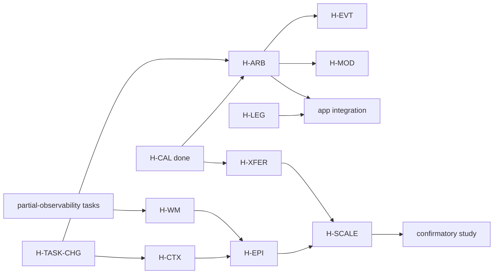

# Hypothesis Registry and Experiment Plan

One entry per major mechanism of the target architecture
([`COGNITIVE_ARCHITECTURE.md`](../architecture/COGNITIVE_ARCHITECTURE.md)). This file also carries the benchmark
specification (§2), the baseline and ablation plan (§3) and the statistical analysis plan (§4).

**Rules that apply to every entry** (from [`COGNITIVE_EXPERIMENT_PROTOCOL.md`](../COGNITIVE_EXPERIMENT_PROTOCOL.md)):
design on `dev` worlds; freeze a gate specification in a commit; run once on a domain never used before; record
the result whatever it is; never tune on a gate domain; a failed gate stays failed.

## 1. Hypotheses

| ID | Tier | Question | Mechanism | Status |
|---|---|---|---|---|
| H-CAL | A | Can the learned model be calibrated without losing performance? | Pooled priors across pairs | **PASS** (CF-03b) |
| H-TASK-CHG | A | Does a hidden-change task separate agents that adapt from agents that do not? | Task E4 (stochastic edges, an unannounced block, then its removal) | **Admitted** (CF-04: +160.7 [135.2, 188.2]; sham null) |
| H-ARB | A | Does reliability arbitration beat either controller alone? | Planner + habit + monitor + selector | **Not supported; harmful** (CF-04: planner − ARB = −13.8 [−20.0, −7.2]; worse than random switching) |
| H-CAL-OOD | A | Is the model calibrated on reliability families it was not developed on? | The repaired v3 model against constant and Laplace forecasters | **Partial** (CF-03c: holds in 1 of 4 unseen families) |
| H-REC-BONUS | A | Can a blanket exploration bonus or blanket belief decay recover a reopened route? | κ√τ in value iteration; decay toward the untried-pair belief; Dyna-Q+ baseline | **Not supported at development level; closed without a gate** (CF-05 closure: best settings do nothing measurable, stronger ones cost +62 to +87 steps) |
| H-REC-RECALL | A | Can remembering an exit's belief from before it was declared worse recover a reopened route without unacceptable cost? | RECALL, hazard 0.01 | **Supported at a cost** (CF-05b: +18.8 [12.6, 25.1] after reversal; +7.7 [2.3, 12.1] when permanent, R4 fails; point break-even p 0.35 [0.16, 0.51], helps at 95% only for p ≥ 0.55; mostly real reversals, about 89%, with interaction). Not adopted |
| H-BEL | A | Does a belief about each changed exit — its old regime remembered, failed re-tests weighed as evidence of whether it will change back — beat every fixed willingness to re-test? | Model v6 with ρ fixed at 1/2 (two-regime belief per exit, no learning across changes) | **CF-06 primary (draft revision 3, 2026-11-15, owner's choice "Re-scope to belief"; revision 3.1, 2026-11-16: n = 135, gainShape in the verdict line, gain attributed by category with privileged diagnostic arms)**. Dev: beats all four fixed policies on the mix, from a minority of worlds (TAIL-DRIVEN) |
| H-VOL | A | Can the agent learn from experience how often changes reverse, and so re-test only where it pays? | Two-regime belief per exit inside the model, switching rate learned and pooled across exits | **Not admitted by task E5** (CF-06 dev, 2026-11-15): an agent told the true rate gains only +14.5 [−8.2, 42.4] steps over ρ = 1/2, below what 60 worlds can detect (at the revised n = 135 about the detectable size, while learning itself would have power about 0.23); VOL gains +4.4. Reported in CF-06, not tested. Needs a task with a **headroom rule** (true-rate reference − fixed-ρ control ≥ 2× the detectable effect on fresh development worlds) |
| H-VOL-DRIFT | B | If the reversal rate itself drifts within a run, does a learner that discounts old changes beat one that pools them all? | Forgetting or change detection on ρ | Open question recorded 2026-11-15 (owner's CF-06 corrections). Not testable inside CF-06: E5 holds ρ fixed per family, and adding a drift family would need its own admission evidence |
| H-VOL-CONT | B | Does the belief hold up when reversal delays follow a distribution the model does not assume (not geometric; varied, long-tailed)? | Same model under unfamiliar delay laws, then a delay law learned rather than fixed by h | Open question recorded 2026-11-15. Not testable inside CF-06: E5 reverses after exactly 10 episodes; h-sensitivity (0.003, 0.03) is the only probe in CF-06 |
| H-VOL-XFER | B | Does a reversal rate learned in one world help from the first change in the next world of the same family? | Carry ρ (as a prior) across worlds | Open question. Six changes per run limit what one run can teach (CF-06 ideal-observer bound); transfer is the direct remedy |
| H-LEG | A | How does the legacy agent compare with baselines on equal information? | Legacy adapter on the battery | Not started |
| H-EVT | B | Does planning on demand keep return at fewer backups? | Triggers: surprise, goal change, tie | Not started |
| H-CTX | B | Do contexts beat forgetting when a regime returns? | Context split on sustained surprise | Not started |
| H-WM | B | Does a gated memory slot solve a task a memoryless agent cannot? | Learned store / keep actions | Not started |
| H-EPI | B | Does cue-matched retrieval beat mismatched retrieval? | Episodic ring keyed by context cue | Not started |
| H-XFER | B | Do pooled priors learned in one world help in an unseen world of the same family? | Carry μ, S, ν across worlds | Not started |
| H-MOD | C | Do modulators change behaviour measurably? | Exploration scale and thresholds from monitor signals | Not started |
| H-BLK | C | Is the impassable-exit component a net gain? | Mixture weight π | Open after CF-03b (helps detour, costs relocation) |
| H-SCALE | C | Do the results hold at 100–200 nodes and under noise? | Same agents, larger families | Not started |

### H-ARB — reliability arbitration (worked in full; the others follow the same template)

| Field | Content |
|---|---|
| Research question | When the world changes, does an agent that switches between a planner and a habit learner by their measured reliability do better than either alone? |
| Mechanism | Reliability of each controller = 1 − running mean of its normalised prediction error. Hard switch when the difference crosses a threshold. One selector; controller id logged per decision |
| Expected effect | In the window after a hidden change, return ≥ planner-only (which acts on a stale model) and > habit-only on the first post-change episodes; no loss on stationary tasks beyond the margin |
| Null hypothesis | Arbitrated return equals the better single controller on every task |
| Competing explanations | (a) Any switching helps by adding exploration: control = switching at random at the same rate. (b) The gain is the habit learner alone: control = habit-only. (c) The planner is never unreliable at this scale, so the arbiter never switches: report the switch count |
| Baselines | Planner-only (MBVI2), habit-only (QL), Dyna-Q, random-switch control, ORACLE reference |
| Conditions | Tasks E1, E3, E2′ (stationary or single change) and E4 (hidden distal change with stochastic edges), on a fresh gate domain |
| Sample size | n = max(20, ⌈(2.8·SD_dev/mean_dev)²⌉), capped at 60, from the dev differences of the primary contrast |
| Primary metric | Steps in the post-change window of E4, arbitrated − planner-only, paired by world |
| Analysis | Paired percentile bootstrap, 10,000 resamples, 95% interval |
| Failure criteria | Interval includes 0 on the primary contrast; or no better than random-switch; or worse than planner-only beyond 10 steps on any stationary task; or the controller id never changes |
| Reproducibility | Seed labels; two in-process runs must give identical row hashes; result and spec hashes recorded |

### The other hypotheses, in brief

| ID | Null | Decisive control | Primary metric | Fails if |
|---|---|---|---|---|
| H-TASK-CHG | The task does not separate MBVI2 from QL or from a no-reset planner | Sham change that does not alter the shortest path | Post-change steps, no-reset planner − MBVI2 | Interval includes 0, or the sham produces the same difference |
| H-LEG | Legacy agent = Dyna-Q on equal information | Privileged mode reported separately and labelled | Battery metrics against QL, DYNAQ, MBVI2 | Descriptive study: no pass/fail, but the result is published either way |
| H-EVT | Triggered planning loses return | Plan-every-step at equal total backups | Backups per decision at return within the margin | Saves less than a pre-stated share (to be fixed on dev), or loses more than the margin |
| H-CTX | Context split = discounted counts | Discounting with the best dev half-life | Steps in the first episode after the return to regime A | No faster than discounting |
| H-WM | Gated slot = memoryless | k-step history agent | Choice accuracy at the junction for delays > k | No better than k-history, or the gate does not learn within the budget |
| H-EPI | Matched retrieval = mismatched | Retrieval with a shuffled cue | First-episode return after recurrence | Mismatched does as well (the test the legacy store failed) |
| H-XFER | Family prior = fresh prior | Prior from a mismatched family | Steps and calibration in the first episodes of a new world | Matched no better than mismatched |
| H-MOD | Clamped = free | The same agent with the modulator fixed at its mean | Coverage in exploration; recovery after change | Clamping changes nothing |
| H-BLK | π = 0.05 equals π = 0 | Task with never-tried blocked exits against a relocation task | Steps on each | No task where it helps without costing elsewhere |
| H-SCALE | Effects at 24 nodes vanish at 200 | Same seeds rule, larger families | The CF-03b contrasts | Signs change or intervals include 0 |

## 2. Benchmark specification

**Environment.** `cognitive/testbed/env.mjs`: the environment owns position, topology, reliabilities, blocks and
reward; the agent receives `{node, nActions, goal}`; actions are opaque permuted indices; every agent on a world
shares the same per-edge random draws.

| Stage | Property added | Task | Capability it tests | Status |
|---|---|---|---|---|
| 1 | Small, fully observed | E1 latent learning | Uses a learned map toward a stated goal | Admitted (CF-01) |
| 1 | | E2′ detour after pre-exposure | Re-plans around a block | Admitted (CF-01b) |
| 1 | | E3 reward relocation | Revalues without relearning the map | Admitted (CF-01) |
| 2 | Noise | E1S hidden reliabilities | Learns and calibrates probabilities | In use (CF-03, CF-03b) |
| 3 | Hidden change, recurrence | E4 distal change; E4R A→B→A | Change detection; context reinstatement | To build (M2) |
| 4 | Partial observability | E6 cue T-maze with delay sweep; aliased graph | Working memory; state estimation | To build (M5) |
| 5 | Transfer | E5 unseen world of a known family | Consolidated priors | To build (M6) |
| 6 | Scale | 48 / 96 / 200 nodes; structured families | Planning cost; adaptive compute | To build (M7) |
| 7 | Conflicting goals, long horizon | Two cues with different rewards; rooms and bottlenecks | Goal management; hierarchy | Deferred until stages 3–6 are done |
| 8 | Causal structure | Intervention task (which of two cues causes the reward) | Causal against correlational learning | Deferred; design not started |

A task is **admitted** only if a pre-declared gate shows it separates the agents it is meant to separate.

**Metrics.** Steps to goal summed over test episodes (primary); censoring rate; return; post-change window steps;
model log-likelihood against a uniform predictor; calibration (weighted per-run ECE, pooled ECE, and the noise
floor of the statistic); backups and sweeps per decision; controller switch counts and decisive share per module.

## 3. Baselines and ablations

| Baseline | Role | Status |
|---|---|---|
| RANDOM | Floor | Built |
| QL | Model-free | Built |
| DYNAQ | Weak model-based (last-outcome model) | Built |
| MBVI (v1 model) | Previous planner | Built, frozen |
| MBVI2 | Current planner | Built |
| ORACLE | Privileged upper reference | Built |
| Dyna-Q+ with a count model | **Stronger** model-based baseline | To build before any superiority claim |
| Posterior sampling (PSRL) | Alternative exploration | To build |
| Successor representation | Diagnostic: fast on revaluation, slow on detour | To build |
| k-step history agent | Control for working memory | To build with stage 4 |
| Legacy MiniFlyWire agent | Characterisation | To build (H-LEG) |

Every subsystem of the integrated agent has one ablation, declared with its direction before the gate:

| Subsystem | Ablation | Predicted effect |
|---|---|---|
| Pooled priors | NOPOOL | Calibration error returns (confirmed: +0.106) |
| Impassable-exit mixture | NOBLOCK | Detour worse (confirmed: +4.4); relocation better (observed: −5.7) |
| Local reward change-point | GLOBALRESET | Relocation worse (not confirmed: +6.7 [−1.1, 13.3]) |
| Optimism | NOOPT | Worse everywhere (confirmed in CF-03) |
| Change detection | NORESET | Worse on relocation and detour (confirmed in CF-03) |
| Arbiter | Planner-only; habit-only; random switch | Worse in the post-change window |
| Planning trigger | Plan every step | Same return, more backups |
| Working-memory gate | Slot disabled | Chance at the junction |
| Episodic retrieval | Shuffled cue | No first-episode advantage |
| Modulators | Clamped | Slower recovery, lower coverage |

## 4. Statistical analysis plan

- **Unit.** The world. Every contrast is paired within world; agents share environment random draws.
- **Estimate and interval.** Mean paired difference with a percentile bootstrap, 10,000 resamples, 95%.
- **Sample size.** Fixed before the gate by the rule above, from dev differences of the primary contrast.
- **Multiplicity.** A gate passes only if every listed criterion holds, which is conservative for the gate as a
  whole. Ablation contrasts are reported with pre-declared directions and are not pass/fail. A family of
  directional claims in a publication will use Holm correction.
- **Exploratory against confirmatory.** Everything so far is a development gate. Confirmatory status needs a
  frozen, pushed protocol, a fresh domain and an independent reproduction (roadmap M9).
- **Known weaknesses of the plan.** 20 worlds give wide intervals on heavy-tailed step counts; censored episodes
  are counted at the cap, which biases differences toward zero; all worlds come from one generator.

## 5. Experiment dependencies

